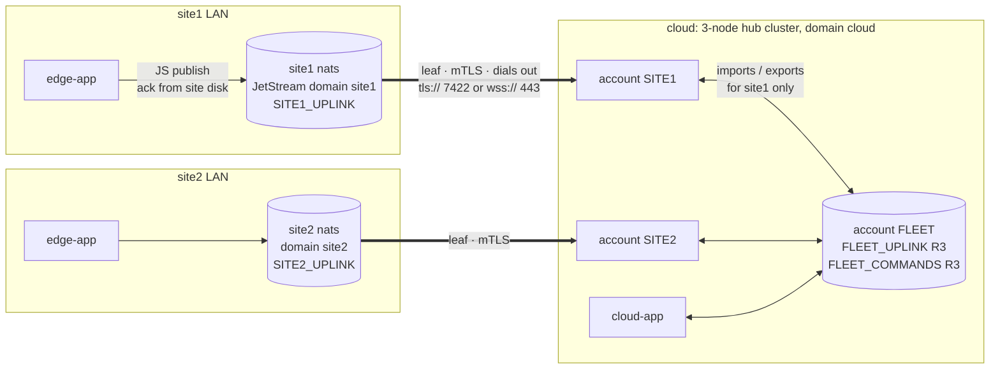

# NATS edge-to-cloud: site leaf nodes + 3-node cloud hub

Sites dial out to the cloud over one TLS connection, so they work behind NAT.
Edge apps only ever talk to the NATS server on their own site LAN. Delivery is
reliable in both directions, and every site is isolated in its own account.

- Design write-up with diagram: [`docs/index.html`](docs/index.html)
- Why a NATS leaf and not an HTTP bridge: [`docs/adr/0001-site-to-cloud-transport.md`](docs/adr/0001-site-to-cloud-transport.md)
- The MQTT design's failure modes checked against this one, and what production still needs: [`docs/production-readiness.md`](docs/production-readiness.md)

All behaviour below was measured with the scripts in `test/` on nats-server
v2.12.1 and nats.go v1.46.1, unless marked otherwise.



## How messages flow

| Traffic | Where it waits during an outage | How it gets there |
|---|---|---|
| Uplink: telemetry, health, command results | **Site** disk (`SITEn_UPLINK`) | The edge app's publish is acked by its own site server. `FLEET_UPLINK` *sources* each site stream over the leaf and resumes from its last sequence |
| Commands | **Cloud** disk (`FLEET_COMMANDS`, work queue, R3) | Each site pulls its **own** durable consumer `siteN-commands` through its leaf, using the API prefix `$JS.hub.API` |
| Stale commands | Deleted in the cloud | Per-message `Nats-TTL` (`allow_msg_ttl`), so a stale command is never shipped |
| Site online/offline | — | Hub system events `$SYS.ACCOUNT.SITEn.{CONNECT,DISCONNECT}`, carrying the site's cert identity |

## Security

**Identity, one certificate per site.** Each site has its own client cert
(`CN=leaf-siteN,O=fleet`). The hub's leaf and WebSocket listeners use
`verify_and_map`, so the cert subject *is* the hub user. There are no shared
passwords, and revoking one site touches no other.

**Isolation, one account per site.** The hub has an account per site
(`SITE1`, `SITE2`, …) plus `FLEET` for the cloud. A site's leaf binds to its
own account, and an account sees only what it explicitly imports. Generated by
`gen-hub-accounts.sh`, each site account allows exactly:

| Direction | What crosses | Why |
|---|---|---|
| `SITEn` → `FLEET` | service `$JS.siteN.API.>` | the hub sources `SITEn_UPLINK` |
| | service `$JS.FC.SITEn_UPLINK.>` | flow control for that copy |
| | stream `fleet.deliver.siteN.>` | the sourced messages |
| `FLEET` → `SITEn` | service `CONSUMER.MSG.NEXT` / `CONSUMER.INFO` on `FLEET_COMMANDS.siteN-commands` | the site pulls **its own** commands |
| | service `$JS.ACK.FLEET_COMMANDS.siteN-commands.>` | and acks them |

Nothing else crosses. In particular a site cannot reach another site's
consumer, cannot publish commands, and never sees another site's reply
subjects (`$JSC.R.*`, `$JS.FC.*`, `_INBOX.*`).

**Cluster routes.** Route TLS uses `verify_cert_and_check_known_urls`: the peer
cert needs a DNS SAN matching a configured route host. Site certs come from the
same CA but have no DNS SAN, so a site can't join the hub cluster.

**Site LAN.** `edge-app` may publish only `sites.siteN.>` (never command
requests) and use only its own command consumer. `site-ops` is for provisioning.

## Files

| Path | What it is |
|---|---|
| `config/cloud-hub.conf` | Hub node config, one file for all 3 nodes (`HUB_NAME` env). Set `advertise` to the public/LB name |
| `config/hub-accounts.conf` | **Generated** per-site accounts: `./gen-hub-accounts.sh site1 site2 … > config/hub-accounts.conf` |
| `config/siteN-leaf.conf` | Site server; includes a commented `wss://` + HTTP-proxy alternative |
| `streams/*.json` | Stream and consumer definitions (`nats stream add --config …`) |
| `gen-certs.sh` | Fleet CA, hub cert (all hub DNS names), one client cert per site |
| `gen-hub-accounts.sh` | Hub accounts file for a list of sites |
| `test/` | Go harness and the scenarios below |

### Adding a site

```bash
./gen-certs.sh cloud-hub.example.com,cloud-hub-1,cloud-hub-2,cloud-hub-3 site3   # site3's key stays on site3
./gen-hub-accounts.sh site1 site2 site3 > config/hub-accounts.conf             # then reload each hub node
sed 's/site1/site3/g; s/SITE1/SITE3/g' config/site1-leaf.conf > config/site3-leaf.conf
nats --server site3 stream add --config SITE3_UPLINK.json                       # from streams/SITE1_UPLINK.json
nats --server cloud consumer add FLEET_COMMANDS --config site3-commands.consumer.json
nats --server cloud stream edit FLEET_UPLINK                                    # add the SITE3_UPLINK source,
                                                                                #   deliver prefix fleet.deliver.site3
```

## Running the tests

Needs `nats-server` (2.12.x), Go and Python 3. The scripts generate test certs,
build the harness and run 3 hub nodes plus 2 site servers on localhost. Site1's
WAN goes through a proxy the scripts kill and restore.

```bash
test/scenario.sh          # outage, catch-up, TTL expiry, isolation, cross-site sniff
test/scenario-crash.sh    # kill -9 site server and a hub node mid-outage; leaf events
test/scenario-cluster.sh  # kill the stream leader mid catch-up (100k backlog); rogue route
test/scenario-wss.sh      # leaf over wss:// through an HTTP CONNECT proxy
```

## Verified results

| Scenario | Result |
|---|---|
| WAN cut, site publishes 20 more | all acked from site disk; cloud stays at 10 |
| WAN restored | 30/30 in cloud, in order, 0 gaps |
| Commands queued during the cut, TTL 15 m and 5 s | 5 s one deleted in the cloud; 15 m one delivered after restore, ack empties the queue |
| Site server `kill -9` + hub node `kill -9`, both mid-outage | 40/40, 0 gaps; queued command delivered |
| 100,000-message backlog; `FLEET_UPLINK` leader `kill -9` at 1,334 copied | new leader finished 100,000/100,000 in 11 s, 0 gaps; queued command delivered; killed node rejoined with lag 0 |
| site1 full-rights user asks for site2's consumer | refused: not imported into site1's account (`no responders`) |
| site1 publishes a command request | Permissions Violation |
| site1 full-rights user subscribes to `>` while site2 is busy | 0 messages mentioning site2 |
| leaf with a valid CA-signed cert, unknown CN | `Authorization Violation` |
| site cert tries to join the hub cluster as a route | rejected every attempt (`Authentication Failure`), never a replica |
| leaf over `wss://` through an HTTP CONNECT proxy | same cert, same account: 20/20 uplink, command delivered, isolation holds |
| black-holed WAN (socket open, no traffic) | link dropped after 61 s with `ping_interval 20s`, `ping_max 2` |
| WAN cut / restore | `$SYS.ACCOUNT.SITE1.DISCONNECT` / `CONNECT` with `user=CN=leaf-site1,O=fleet` |

### Behaviours to plan for (measured)

- **Catch-up can start late.** After an outage the site reconnects within
  seconds, but a source that kept failing waits out its retry backoff:
  `retryBackOff = 5s × fails×2`, capped at `retryMaximum = 2m`
  (`server/stream.go`). Measured 37–58 s between reconnect and the copy
  starting. Nothing is lost; commands are unaffected because they are pulled.
- **After a hub node dies, ~1 in 3 new ephemeral R1 consumers time out for
  about 3 minutes.** They get placed on the dead peer. nats.go's
  `OrderedConsumer` is one of these, and its `Next()` then blocked past its own
  max-wait. Durable R3 consumers were unaffected: site command pulls and the
  uplink copy carried on. Cloud apps should use durable consumers, or create
  ephemerals with a short timeout and retry. Not root-caused.
- **Remote config order:** in a leaf remote, `proxy { }` must come after
  `tls { }`, or nats-server 2.12.1 rejects the config.
- **`advertise` is required** on the hub's leaf listener. A connecting leaf
  always receives the hub's own leaf URL, and `no_advertise` only affects cluster
  routes. Without it, leaves reconnect around the load balancer (`server/leafnode.go`).
- **Sites reach the command consumer via `$JS.hub.API`, not `$JS.cloud.API`.**
  The hub intercepts its own domain prefix in every account and answers
  "JetStream not enabled for account" before the import applies.

## Application responsibilities

The infrastructure can't do these for you:
- Delivery is at-least-once. Dedupe commands on `commandId` at the edge, and set
  `Nats-Msg-Id` on every uplink publish.
- Keep the `expiresAt` check at the edge, which covers time a command spends at
  the site after it ships.
- A redelivery after `ack_wait` can reorder. Keep a per-robot sequence guard
  in the cloud app.
- Handle publish errors when the site stream is full (`discard: new` refuses
  rather than dropping unsent data).

## Still needed before production

See [`docs/production-readiness.md`](docs/production-readiness.md) for details.
1. Load test at fleet size: hundreds of sources on `FLEET_UPLINK`, and a
   regional reconnect storm. Tested here with 2 sites.
2. Power-cut test on real site hardware with `sync_interval: always`, and
   measure its throughput cost there.
3. Monitoring: per-source last-seen on `FLEET_UPLINK`, leaf DISCONNECT events,
   command queue age, site stream fill.
4. Certificate rotation runbook, plus revocation (OCSP or a CRL) on the leaf and
   WebSocket listeners.
5. Pin and retest the nats-server version you deploy.
