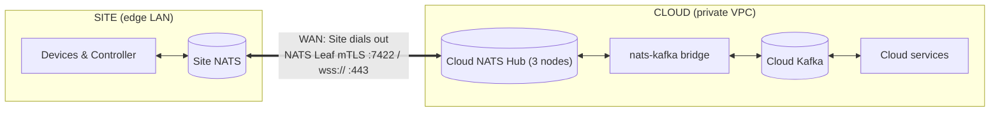
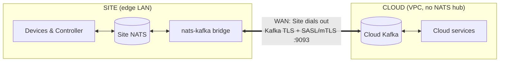
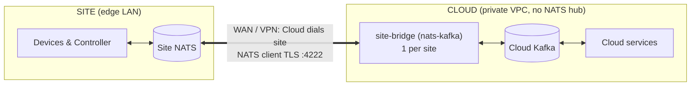

# Cloud Kafka ↔ Site NATS: Architecture Patterns

Three runnable, zero-custom-code patterns for connecting **Cloud services on
Kafka** with **remote sites on NATS**, kept side by side in separate
directories so you can compare and choose the right fit.

| Pattern | Directory | Where `nats-kafka` runs | Cloud NATS Hub? | WAN direction | Best for |
|---|---|---|---|---|---|
| **Pattern A: Cloud NATS Hub + Leaf** | [pattern-a-cloud-hub/](pattern-a-cloud-hub/README.md) | **Cloud** (1 shared) | Yes (3 nodes) | Site dials **out** (`mTLS :7422` / `wss:// :443`) | 50–500+ sites behind NAT/firewalls, Kafka private in VPC, minimal site ops |
| **Pattern B: Site Bridge → Cloud Kafka** | [pattern-b-direct-kafka/](pattern-b-direct-kafka/README.md) | **Site** (1 per site) | No | Site dials **out** (Kafka `:9093`) | Small site count on VPN where Kafka is reachable over WAN and no Cloud NATS is wanted |
| **Pattern C: Cloud Bridge → Site NATS** | [pattern-c-cloud-bridge-direct/](pattern-c-cloud-bridge-direct/README.md) | **Cloud** (1 per site) | No | Cloud dials **in** (NATS `:4222` over VPN) | Private site-to-cloud VPN, Kafka private in VPC, minimal site ops, no Cloud NATS hub |

Full comparison: **[docs/comparison.md](docs/comparison.md)** ·
**[ADR-0003](docs/adr/0003-direct-site-to-kafka-vs-cloud-hub.md)**.

---

## All three patterns at a glance (Site vs Cloud boundary)

### Pattern A — Cloud NATS Hub + Cloud Bridge ([`pattern-a-cloud-hub/`](pattern-a-cloud-hub/README.md))



### Pattern B — Site Bridge → Cloud Kafka ([`pattern-b-direct-kafka/`](pattern-b-direct-kafka/README.md))



### Pattern C — Cloud Bridge → Site NATS ([`pattern-c-cloud-bridge-direct/`](pattern-c-cloud-bridge-direct/README.md))



---

## Quickstart

All three stacks need Docker and Make (Pattern A also uses OpenSSL for dev
mTLS certs; Go 1.24+ is only needed for Pattern A's `e2e/` test suite). Run
one stack at a time so host ports don't collide.

```bash
# Pattern A: Cloud NATS Hub + Cloud Bridge
cd pattern-a-cloud-hub && make up          # make test · make kafka-status · make down

# Pattern B: Site Bridge -> Cloud Kafka
cd pattern-b-direct-kafka && make up       # make status · make kafka-status · make down

# Pattern C: Cloud Bridge -> Site NATS
cd pattern-c-cloud-bridge-direct && make up  # make status · make kafka-status · make down
```

---

## Repository layout

```text
.
├── README.md                          # overview of Patterns A, B, and C
├── docs/
│   ├── comparison.md                  # Pattern A vs B vs C comparison & diagrams
│   ├── load-test-2mbps.md             # 2 Mbps WAN load test results (Pattern A)
│   ├── naming.md                      # shared NATS subject & Kafka topic conventions
│   ├── production-readiness.md        # production checklist & failure modes
│   └── adr/
│       ├── 0001-site-to-cloud-transport.md
│       ├── 0002-kafka-nats-bridge.md
│       └── 0003-direct-site-to-kafka-vs-cloud-hub.md
├── pattern-a-cloud-hub/               # Pattern A: Cloud Kafka <-> Cloud nats-kafka <-> Cloud NATS Hub ==Leaf==> Site NATS
├── pattern-b-direct-kafka/            # Pattern B: Cloud Kafka ==WAN==> Site nats-kafka <-> Site NATS
└── pattern-c-cloud-bridge-direct/     # Pattern C: Cloud Kafka <-> Cloud nats-kafka (1/site) ==VPN==> Site NATS
```
