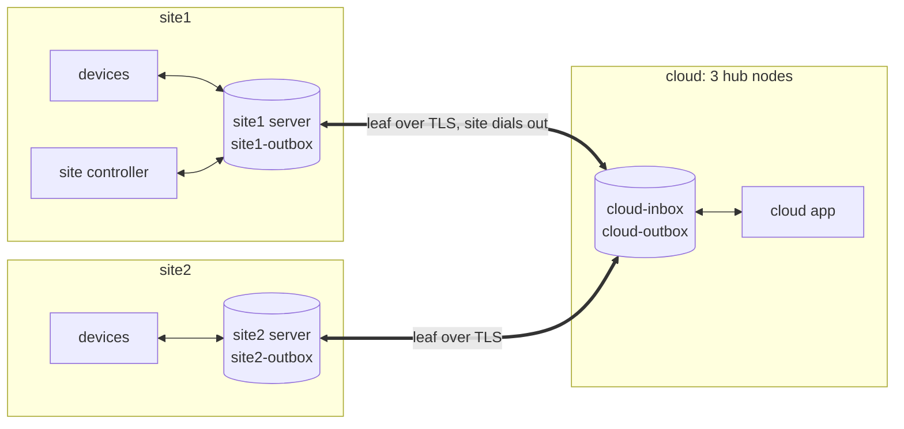

# NATS edge-to-cloud demo

Devices at many sites send events to the cloud, and the cloud sends commands
to sites. Each site runs its own NATS server, which connects out to a 3-node
cloud cluster as a [leaf node](https://docs.nats.io/running-a-nats-service/configuration/leafnodes).
Nothing is lost when a site's WAN link goes down: events wait on the site's
disk, commands wait in the cloud.



## Subjects

Every subject names its hop: `<from>.to.<to>.<id>.<type>`.

| Hop | Subject | Example |
|---|---|---|
| Cloud → site | `cloud.to.site.<site>.<type>` | `cloud.to.site.site1.command` |
| Site → cloud | `site.to.cloud.<site>.<type>` | `site.to.cloud.site1.telemetry` |
| Site → device | `site.to.device.<device>.<type>` | `site.to.device.arm-01.command` |
| Device → site | `device.to.site.<device>.<type>` | `device.to.site.arm-01.telemetry` |

The cloud never sees device ids. On the way up, the site forwards
`device.to.site.<device>.<type>` as `site.to.cloud.<site>.<type>`. On the way
down, a site controller decides which device runs a command. Full rules:
[docs/naming.md](docs/naming.md).

## Run it

Needs Docker, Make, OpenSSL, and Go 1.24+ for the tests.

```bash
make up              # dev certs, generated config, 3 hubs, 2 sites, streams
make test            # end-to-end tests: forwarding, naming, outages, crashes
make down            # stop and delete all data
```

Try an outage by hand:

```bash
make cut-site1       # site1 loses its WAN link; its devices keep publishing
make restore-site1   # site1's events catch up in the cloud
make kill-cloud-hub-2 start-cloud-hub-2
make status          # streams, leaders, replicas
```

| Connect as | Address | User (dev password) |
|---|---|---|
| Cloud app | `tls://localhost:4222`, `:4232`, `:4242`, CA `certs/ca.crt` | `cloud-app` (`dev-cloud`) |
| Device | site1 `nats://localhost:4223`, site2 `:4224` | `device` (`dev-device`) |
| Site controller | same as device | `site-controller` (`dev-controller`) |
| Monitoring | hub1 `http://localhost:8222`, site1 `:8223`, site2 `:8224` | |

## Layout

```
compose.yaml          3 hubs, 2 sites, one-shot stream setup (nats-box)
Makefile              up, down, test, cut/restore a site, kill/start a server
config/hub.conf       hub node config
config/streams/       cloud-outbox definition
config/generated/     per-site config, made by scripts/generate.sh (not in git)
scripts/              generate.sh, gen-certs.sh, setup.sh
e2e/                  Go end-to-end tests, including the naming check
docs/naming.md        naming convention
docs/guide.md         how it works
docs/adr/             why a leaf node rather than an HTTP bridge
docs/production-readiness.md
```
