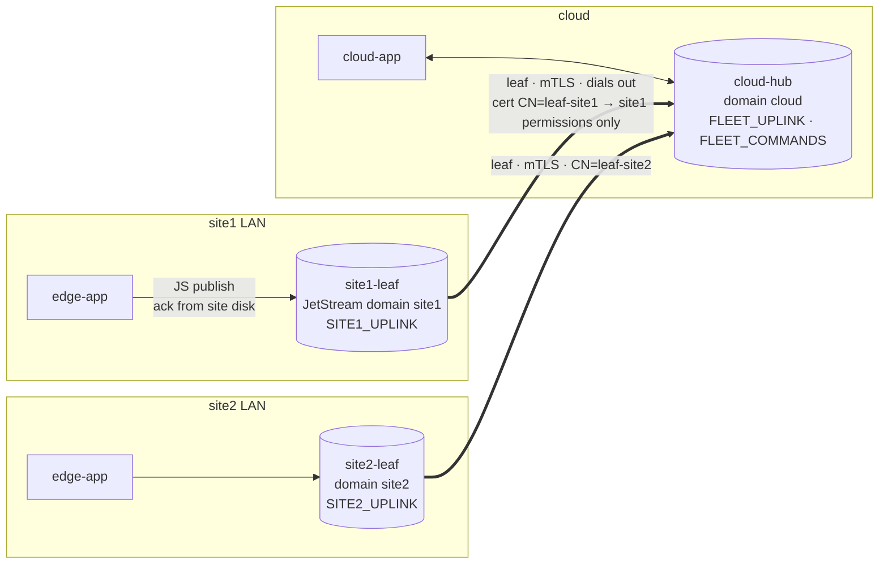

# Cloud hub + site leaf nodes: reliable, per-site-secured NATS

Full write-up with diagram: [`docs/index.html`](docs/index.html). The MQTT failure modes checked against this design, and what production still needs: [`docs/production-readiness.md`](docs/production-readiness.md).

Sites dial out to the cloud over one TLS connection, so they work behind NAT.
Edge apps only ever talk to the NATS server on their own site LAN.

| Traffic | Where it waits during an outage | How it gets there |
|---|---|---|
| Uplink: telemetry, health, command results | **site** disk (`SITE1_UPLINK`) | `FLEET_UPLINK` sources each site stream over the leaf link and resumes from its last sequence |
| Commands | **cloud** disk (`FLEET_COMMANDS`, work queue) | each site pulls its **own** durable consumer `siteN-commands` through its leaf (`$JS.cloud.API`) |
| Stale commands | removed in the cloud | `Nats-TTL` header per command (`allow_msg_ttl`), so a stale command is never shipped |

## Per-leaf security
- **Identity**: each site has its own client cert (`CN=leaf-siteN,O=fleet`). The hub uses `verify_and_map`, so the cert subject *is* the user. There are no shared passwords. Revoking one site touches nothing else.
- **Authorization** (on the hub, per site):
  - pull and ack only `FLEET_COMMANDS.siteN-commands`
  - deliver uplink only on `fleet.deliver.siteN.>`
  - expose only its own `$JS.siteN.API`
  - publish `sites.*.command.*.req` is denied, so a site can never inject commands, even for its own robots
- **Site LAN**: `edge-app` is limited to `sites.siteN.>` and its own consumer. `site-ops` is for provisioning only.

## Files
| | |
|---|---|
| `config/cloud-hub.conf` | hub. Set `advertise` to the public/LB name (see comment) |
| `config/siteN-leaf.conf` | leaf per site |
| `streams/*.json` | stream/consumer definitions (`nats stream add --config …`). Copy `SITE1_UPLINK` / `site1-commands` per site and add a `sources` entry per site to `FLEET_UPLINK` |
| `gen-certs.sh` | fleet CA, hub cert, one client cert per site |
| `test/` | harness; `scenario.sh` (outage, TTL, isolation), `scenario-crash.sh` (site/hub `kill -9` mid-outage, leaf events) |

## Verified (nats-server v2.12.1, nats.go v1.46.1, 1 hub + 2 leaves, site1's WAN through a killable TCP proxy)

| Check | Result |
|---|---|
| 10 msgs with link up | cloud 10/10 |
| WAN cut; site publishes seq 11–30 | all 20 acked locally; cloud stays at 10 |
| Cloud queues cmd (TTL 15m) + cmd (TTL 5s) during cut | site pull fails (no responders); queue holds both |
| After 7s | TTL removed the 5s command; pending = 1 |
| WAN restored | cloud 30/30, in order, 0 gaps; site gets **only** the fresh command; ack empties the queue |
| site1 `site-ops` (full rights on its own leaf) asks for `site2-commands` | refused at the hub (leaf permissions) |
| site1 publishes `sites.site1.command.arm-01.req` | Permissions Violation |
| leaf with a valid CA-signed cert but unknown CN (`leaf-site3`) | `Authorization Violation`, rejected |

Two things the test caught that the first draft got wrong:
1. **Sourcing over a locked-down leaf** needs the site to publish `$JS.S.*` / `$JSC.R.*` (server/stream.go `syncSubject("$JS.S")`, `infoReplySubject()`). `external.deliver` moves the data subject to a per-site prefix, so it can be scoped per leaf.
2. **The hub always advertises its own leaf URL** to leaves (server/leafnode.go). `no_advertise` only affects cluster routes (server/route.go). Without `advertise`, the leaf reconnected straight to the hub's private IP and skipped the simulated WAN.

## Not covered yet
- `$JSC.R.>` (publish) and `$JS.FC.>` / `_INBOX.>` (subscribe) are not per-site. They are random reply subjects, so the risk is low, but a site could in principle reach another site's reply subject. Use separate accounts per site with exports/imports to remove that, at the cost of more config.
- Single hub node in the test. Production needs a 3-node hub cluster (`num_replicas: 3` is already in the JSON).
- Apps should treat delivery as at-least-once: dedupe on `commandId`, and keep the `expiresAt` check at the edge.
