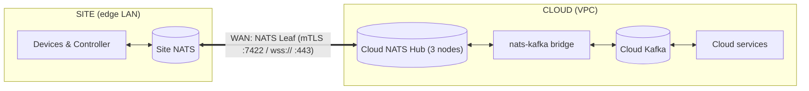
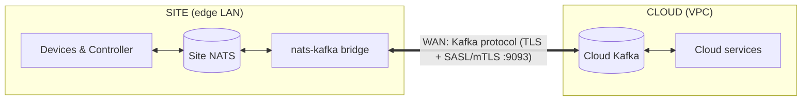

# Cloud Kafka ↔ Site NATS: Architecture Patterns

Two runnable, zero-custom-code patterns for connecting **Cloud services on
Kafka** with **remote sites on NATS**, kept side by side so you can compare
and choose the right fit.

| Pattern | Directory | Topology | Best for |
|---|---|---|---|
| **Pattern A: Cloud NATS Hub + Leaf Nodes** | [pattern-a-cloud-hub/](pattern-a-cloud-hub/README.md) | Cloud Kafka ↔ Cloud `nats-kafka` ↔ Cloud NATS Hub (3 nodes) ══Leaf══ Site NATS | 50–500+ sites, restrictive firewalls (`wss:// :443`), keeping Kafka private in cloud VPC, minimal site footprint |
| **Pattern B: Direct Site-to-Kafka** | [pattern-b-direct-kafka/](pattern-b-direct-kafka/README.md) | Cloud Kafka ══WAN══ Site `nats-kafka` ↔ Site NATS *(no Cloud NATS hub)* | Fewer sites on a private VPN to cloud VPC, avoiding a Cloud NATS cluster |

Full side-by-side breakdown: **[docs/comparison.md](docs/comparison.md)** ·
**[ADR-0003](docs/adr/0003-direct-site-to-kafka-vs-cloud-hub.md)**.

---

## Both patterns at a glance (Site vs Cloud boundary)

### Pattern A — Bridge in the Cloud ([`pattern-a-cloud-hub/`](pattern-a-cloud-hub/README.md))



### Pattern B — Bridge at the Site ([`pattern-b-direct-kafka/`](pattern-b-direct-kafka/README.md))



---

## Quickstart

Both stacks need Docker, Make, and OpenSSL (Go 1.24+ is only needed to run
Pattern A's `e2e/` test suite). Run one stack at a time so ports don't collide.

### Run Pattern A (Cloud NATS Hub + Leaf)

```bash
cd pattern-a-cloud-hub
make up            # Kafka, nats-kafka, 3-node NATS hub, 2 sites, streams & topics
make kafka-status  # check bridge lag on Kafka and NATS
make test          # full Go e2e suite (optional, needs Go 1.24+)
make down
```

### Run Pattern B (Direct Site-to-Kafka)

```bash
cd pattern-b-direct-kafka
make up            # Kafka, 2 sites, per-site nats-kafka bridges
make kafka-status  # check per-site Kafka consumer groups
make status        # check site1/site2 JetStream streams
make down
```

---

## Repository layout

```text
.
├── README.md                          # this overview
├── docs/
│   ├── comparison.md                  # Pattern A vs Pattern B comparison & diagrams
│   ├── load-test-2mbps.md             # 2 Mbps WAN load test results (Pattern A)
│   ├── naming.md                      # shared NATS subject & Kafka topic conventions
│   ├── production-readiness.md        # production checklist & failure modes
│   └── adr/
│       ├── 0001-site-to-cloud-transport.md
│       ├── 0002-kafka-nats-bridge.md
│       └── 0003-direct-site-to-kafka-vs-cloud-hub.md
├── pattern-a-cloud-hub/               # Pattern A: Cloud Kafka <-> Cloud NATS Hub <-> Site NATS
│   ├── README.md                      # detailed guide, diagrams, operations & tests
│   ├── Makefile
│   ├── compose.yaml
│   ├── config/
│   ├── scripts/
│   └── e2e/
└── pattern-b-direct-kafka/            # Pattern B: Cloud Kafka <-> Site nats-kafka <-> Site NATS
    ├── README.md                      # detailed guide, diagrams & operations
    ├── Makefile
    ├── compose.yaml
    └── scripts/
```
