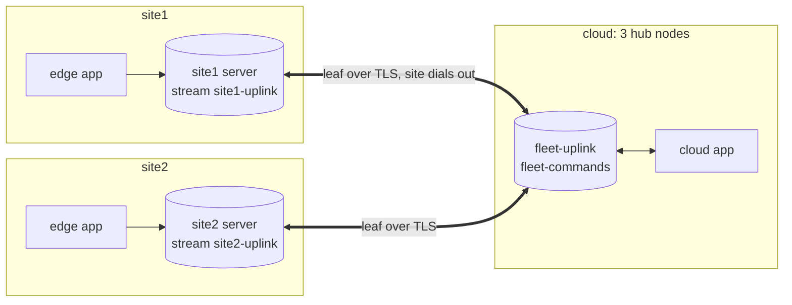

# NATS edge-to-cloud demo

Robots at many sites send events to the cloud and receive commands from it.
Each site runs its own NATS server, which connects out to a 3-node cloud
cluster as a [leaf node](https://docs.nats.io/running-a-nats-service/configuration/leafnodes).
Nothing is lost when a site's WAN link goes down: events wait on the site's
disk, commands wait in the cloud.



## Run it

Needs Docker, Make, OpenSSL, and Go 1.24+ for the tests.

```bash
make up              # dev certs, 3 hubs, 2 sites, streams
make test            # end-to-end tests (WAN cuts, crashes, node loss)
make down            # stop and delete all data
```

Try an outage by hand:

```bash
make cut-site1       # site1 loses its WAN link; its apps keep publishing
make restore-site1   # site1's events catch up in the cloud
make kill-cloud-hub-2 start-cloud-hub-2
make status          # streams, leaders, replicas
```

| Endpoint | Address | User (dev password) |
|---|---|---|
| Cloud (any hub) | `tls://localhost:4222`, `:4232`, `:4242`, CA `certs/ca.crt` | `cloud-app` (`dev-cloud`) |
| site1 / site2 | `nats://localhost:4223` / `:4224` | `edge-app` (`dev-edge`) |
| Monitoring | hub1 `http://localhost:8222`, site1 `:8223`, site2 `:8224` | |

## Subjects

`fleet.<site>.<robot>.<type>`, for example `fleet.site1.arm-01.telemetry`.

| Subject | Direction |
|---|---|
| `fleet.<site>.<robot>.telemetry` | site → cloud |
| `fleet.<site>.<robot>.health` | site → cloud |
| `fleet.<site>.<robot>.command` | cloud → site |
| `fleet.<site>.<robot>.command.result` | site → cloud |

Every other subject is plumbing (`_fleet.*`) or owned by NATS (`$JS.*`,
`$SYS.*`, `_INBOX.*`). The [guide](docs/guide.md#subjects) lists them all.

## Layout

```
compose.yaml        3 hubs, 2 sites, one-shot setup (nats-box)
config/             server configs and stream/consumer definitions
scripts/            dev certs, hub accounts, stream setup
e2e/                Go end-to-end tests
docs/guide.md       how it works
docs/adr/           why a leaf node rather than an HTTP bridge
docs/production-readiness.md
```
