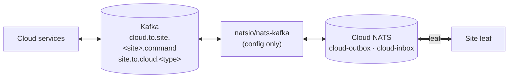

# ADR-0002: Kafka in the cloud, joined to cloud NATS by `nats-io/nats-kafka`

- **Status:** accepted
- **Date:** 2026-11-22
- **Scope:** how cloud services, which publish and consume on Kafka, exchange
  commands and events with sites. The site-to-cloud hop is unchanged
  ([ADR-0001](0001-site-to-cloud-transport.md)).

## Context

- Cloud services already publish to and consume from Kafka. They should not
  have to learn NATS, JetStream domains, or per-site accounts.
- Sites are reached only through the cloud NATS hub over leaf nodes. That hop
  carries the reliability, isolation, and outage properties verified in
  ADR-0001 and `e2e/`, and must keep them.
- We want an **out-of-the-box bridge** with no custom bridge code to write,
  build, or maintain, configured from the same single list of sites as the
  NATS hub and leaf nodes.
- Delivery must stay reliable through a bridge crash in both directions, and
  events for a site must stay ordered in Kafka.

## Options

### A. `nats-io/nats-kafka` — official NATS-Kafka bridge (chosen)

Official standalone bridge (`natsio/nats-kafka:1.4.2`). Config is generated by
`scripts/generate.sh`:
- **Down:** one `KafkaToJetStream` connector per site
  (`cloud.to.site.<site>.command` → `cloud-outbox`).
- **Up:** one `JetStreamToKafka` connector per `(site, type)` bound to
  `cloud-inbox` (`site.to.cloud.<site>.<type>` → `site.to.cloud.<type>`,
  `keytype: fixed`, `keyvalue: <site>`).

### B. Redpanda Connect (formerly Benthos)

Single container (`redpandadata/connect`) with YAML pipelines (`kafka` +
`nats_jetstream`) and inline Bloblang transforms. Can route a single shared
`cloud.to.site.command` topic dynamically using a `siteId` header, compute
remaining `Nats-TTL`, and send invalid commands to a `.rejected` DLQ.

### C. Custom bridge service (Java + Spring Boot, or Go)

Own a small service (`spring-kafka` + `jnats`, or `franz-go` + `nats.go`) with
full control over `siteId` header routing, TTL calculation from Kafka
timestamps, `.rejected` DLQ, and custom metrics/auth.

### D. Kafka Connect with a NATS connector

Run a Kafka Connect cluster with a third-party NATS source/sink plugin plus
custom SMTs for routing and TTL.

### E. Replace Kafka with NATS for cloud services

Cloud services talk to the cloud NATS hub directly (as `cloud-app` does in
`e2e/`).

## Comparison

| Concern | A. `nats-io/nats-kafka` | B. Redpanda Connect | C. Custom service (Java/Go) | D. Kafka Connect | E. No Kafka |
|---|---|---|---|---|---|
| Out-of-the-box, zero custom code | **yes** (official NATS image + generated config) | yes (YAML + Bloblang) | no (service to build & own) | partial (needs Connect cluster + SMTs) | n/a |
| Single shared command topic routed by `siteId` header | **no** — uses one topic per site (`cloud.to.site.<site>.command`) | yes | yes | needs custom SMT | n/a |
| Up: one topic per type, Kafka key = `<site>` | **yes** (`keytype: subjectre`) | yes | yes | depends on connector | n/a |
| JetStream acks & durable consumers | **yes** (`KafkaToJetStream`, `JetStreamToKafka`) | yes | yes | many plugins use core NATS only | n/a |
| Header pass-through (`Nats-Msg-Id`, `Nats-TTL`) | **yes** | yes (+ TTL math from Kafka timestamp) | yes (+ TTL math & `.rejected` DLQ) | depends on connector | publisher sets it |
| Monitoring | built-in `/healthz`, `/varz` | Prometheus / HTTP | Actuator / custom | JMX | n/a |
| Change for cloud services | produce to per-site command topic; read per-type up topics | produce to shared topic with `siteId` header | produce to shared topic with `siteId` header | varies | all move off Kafka |

## Decision

**Use option A (`nats-io/nats-kafka`).** It is the official, out-of-the-box
NATS ↔ Kafka bridge, requires zero custom code, and fits this repo's
config-generation model (`scripts/generate.sh` already generates per-site NATS
accounts, site configs, and streams, so generating per-site `KafkaToJetStream`
connectors and `setup-kafka.sh` topics adds no new workflow).

## Tradeoffs & consequences

- **Per-site command topics (`cloud.to.site.<site>.command`):** because
  `KafkaToJetStream` publishes to a static NATS subject, each site has its own
  Kafka command topic. With `KAFKA_AUTO_CREATE_TOPICS_ENABLE=false`, sending a
  command to an unknown site fails immediately at Kafka.
  - At 50–500 sites this is 50–500 topics (fine for a KRaft cluster with low
    partition counts per command topic, e.g. 1–3 partitions).
  - Adding a site requires regenerating `nats-kafka.conf` and reloading/restarting
    `kafka-bridge`, plus creating the new site's command topic.
- **No dynamic `siteId` header routing or `.rejected` DLQ:** if cloud services
  must produce to a single shared `cloud.to.site.command` topic with only a
  `siteId` header, switch to **option B (Redpanda Connect)** or **option C
  (Java/Spring Boot)**.
- **`Nats-TTL` starts at NATS ingest:** `nats-kafka` passes headers through
  without subtracting time spent queued in Kafka. If the bridge is down for a
  long period, cloud services should also include an `expiresAt` timestamp in
  the command payload for the site controller to check.
- **At-least-once delivery:** consumers should deduplicate on `Nats-Msg-Id` /
  `commandId`.
- **Operations:** monitor `/healthz`, `/varz`, Kafka consumer group lag for
  `kafka-bridge`, and pending acks on `cloud-inbox`'s `kafka-bridge-<type>`
  consumers (`make kafka-status`).

## When to revisit

- Fleet size grows past ~500–1,000 sites and per-site Kafka command topics
  become operationally heavy → move to **Redpanda Connect (B)** or a **Java /
  Spring Boot bridge (C)** with a single `cloud.to.site.command` topic routed
  by the `siteId` header.
- You need TTL countdown while queued in Kafka, schema validation, or a
  `.rejected` dead-letter topic → move to **B** or **C**.
- Cloud services adopt NATS directly → drop the bridge (**E**).
