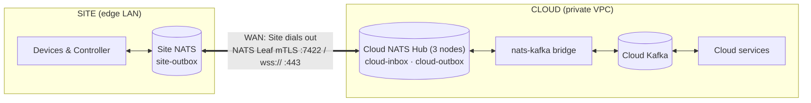
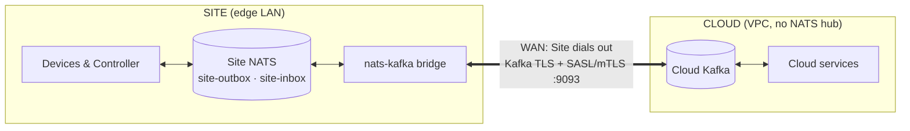
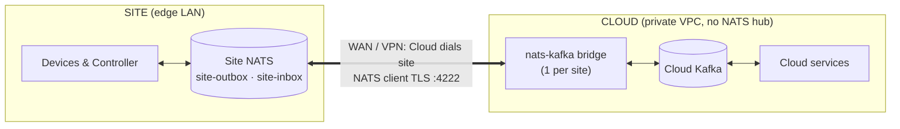

# ADR-0003: Pattern A (Cloud NATS Hub) vs Pattern B (Site Bridge) vs Pattern C (Cloud Bridge → Site NATS)

- **Status:** proposed (all three patterns kept runnable for evaluation)
- **Date:** 2026-11-23
- **Scope:** where the `nats-kafka` bridge runs and whether a Cloud NATS Hub
  sits between sites and Cloud Kafka.

## Context

In both patterns:
- **Cloud services** only talk to **Kafka**.
- **Site devices** only talk to their local **NATS** server (so local disk
  durability in `<site>-outbox` survives WAN outages and site crashes).
- The same **naming convention** ([naming.md](../naming.md)) and Kafka topic
  layout (`cloud.to.site.<site>.command` and `site.to.cloud.<type>`) apply.

The decision is **where the NATS ↔ Kafka boundary sits**: in the cloud
(Pattern A) or at each site (Pattern B).

## Options

### Pattern A: Cloud NATS Hub + Cloud Bridge (`pattern-a-cloud-hub/`)

### Pattern B: Site Bridge → Cloud Kafka (`pattern-b-direct-kafka/`)

### Pattern C: Cloud Bridge → Site NATS (`pattern-c-cloud-bridge-direct/`)

## Comparison

See [docs/comparison.md](../comparison.md) for the full side-by-side matrix of
all three patterns.

## When to choose which

- **Choose Pattern A (`pattern-a-cloud-hub/`)** when:
  - Sites sit behind NAT, restrictive firewalls, or HTTPS-only proxies (`wss:// :443`).
  - Cloud Kafka must stay strictly private inside the cloud VPC.
  - You want minimal site footprint (only `nats-server`), built-in site offline
    events (`$SYS`), and cloud-side command TTL expiry before WAN transfer.
  - You expect 50–500+ sites.
- **Choose Pattern B (`pattern-b-direct-kafka/`)** when:
  - Sites must dial **out** (no inbound VPN from cloud), you have a small
    number of sites, and you want to avoid running a Cloud NATS cluster.
  - Exposing Kafka (with TLS + SASL/mTLS + ACLs) over WAN/VPN is acceptable.
- **Choose Pattern C (`pattern-c-cloud-bridge-direct/`)** when:
  - You already have a private site-to-cloud VPN where the cloud VPC can dial
    into each site's NATS `:4222` over TLS.
  - You want **minimal site footprint** (only `nats-server` at sites),
    **private Cloud Kafka**, and **no Cloud NATS Hub** — and running 1
    lightweight `nats-kafka` container per site in the cloud fits your fleet
    size.
