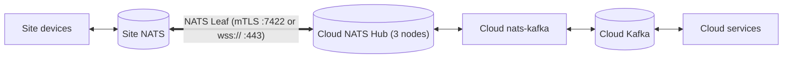
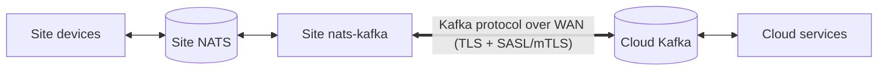

# ADR-0003: Pattern A (Cloud NATS Hub + Leaf) vs Pattern B (Direct Site-to-Kafka)

- **Status:** proposed (both patterns kept runnable for evaluation)
- **Date:** 2026-11-23
- **Scope:** whether remote sites connect to a Cloud NATS hub over leaf nodes
  (Pattern A) or run `nats-kafka` locally to connect straight to Cloud Kafka
  over WAN (Pattern B).

## Context

In both patterns:
- **Cloud services** only talk to **Kafka**.
- **Site devices** only talk to their local **NATS** server (so local disk
  durability in `<site>-outbox` survives WAN outages and site crashes).
- The same **naming convention** ([naming.md](../naming.md)) and Kafka topic
  layout (`cloud.to.site.<site>.command` and `site.to.cloud.<type>`) apply.

The decision is **where the NATS ↔ Kafka boundary sits**: in the cloud
(Pattern A) or at each site (Pattern B).

## Options

### Pattern A: Cloud NATS Hub + Leaf Nodes (`pattern-a-cloud-hub/`)

### Pattern B: Direct Site-to-Kafka (`pattern-b-direct-kafka/`)

## Comparison

| Concern | Pattern A: Cloud NATS Hub (`pattern-a-cloud-hub/`) | Pattern B: Direct Site-to-Kafka (`pattern-b-direct-kafka/`) |
|---|---|---|
| **Cloud components to operate** | Cloud Kafka + 3-node Cloud NATS hub + 1 Cloud `nats-kafka` | Cloud Kafka only (no Cloud NATS cluster) |
| **Site components to operate** | Site NATS only (1 binary, config only) | Site NATS + Site `nats-kafka` (2 containers per site to upgrade & monitor) |
| **WAN transport & firewalls** | Single outbound TCP `:7422` or **`wss:// :443`** through corporate HTTPS proxies | Direct Kafka TCP (`:9093`) to **every broker** (bootstrap + advertised broker addresses); does not traverse HTTP proxies |
| **Kafka exposure** | Kafka stays **strictly private** inside the cloud VPC | Kafka brokers (or a Kafka proxy like Kroxylicious/Envoy) must be reachable from every site over WAN |
| **Per-site security & isolation** | Per-site mTLS cert → isolated NATS hub account; hub enforces zero cross-site visibility | Per-site Kafka mTLS/SASL credentials + Kafka ACLs on every broker |
| **Site-offline detection** | Built-in `$SYS.ACCOUNT.<site>.DISCONNECT` / `CONNECT` (~60–75 s) | No built-in disconnect event; rely on heartbeats or Kafka consumer-group liveness |
| **Stale command expiry** | `Nats-TTL` deletes expired commands in `cloud-outbox` before they ever cross the WAN | Commands wait in Kafka until site reconnects; site controller must drop expired commands via payload `expiresAt` |
| **Kafka outage resilience** | `cloud-inbox` buffers 7 days in the cloud; sites stay connected to the hub | Events stay buffered in each site's `<site>-outbox` until Cloud Kafka returns |
| **Fleet scaling (50–500 sites)** | Hub manages 50–500 leaf connections (designed for this); Kafka only sees 1 cloud bridge | Kafka brokers hold direct WAN TCP connections + consumer group members from 50–500 sites |

## When to choose which

- **Choose Pattern A (`pattern-a-cloud-hub/`)** when:
  - Sites sit behind restrictive firewalls or HTTPS-only proxies (`wss:// :443`).
  - Security policy forbids exposing Cloud Kafka brokers to remote sites.
  - You want minimal site footprint (only `nats-server`), built-in site offline
    events (`$SYS`), and cloud-side command TTL expiry before WAN transfer.
  - You expect 50–500+ sites.
- **Choose Pattern B (`pattern-b-direct-kafka/`)** when:
  - You have a small number of sites with VPN/private WAN directly to the
    cloud VPC (so Kafka broker connectivity is already private and reliable).
  - You want to avoid operating a 3-node Cloud NATS cluster.
  - Sites can comfortably run and upgrade a second container (`nats-kafka`)
    and handle command expiry in the site controller.
