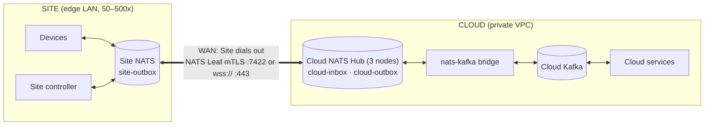
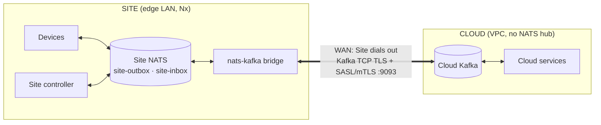
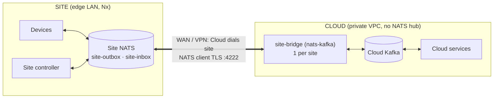

# Pattern Comparison: A vs B vs C

All three patterns in this repository share the same goals:
- **Cloud services** only talk to **Kafka**.
- **Site devices** only talk to their local **NATS** server (local disk
  durability in `<site>-outbox` survives WAN outages and site crashes).
- **Zero custom bridge code** — all three use the official
  [`nats-io/nats-kafka`](https://github.com/nats-io/nats-kafka) image with
  generated config.
- **Same naming & topic rules** ([naming.md](naming.md)).

They differ in **where `nats-kafka` runs**, **whether there is a Cloud NATS
Hub**, and **which side opens the WAN connection**.

## Architecture side by side (Site vs Cloud boundary)

### Pattern A — Cloud NATS Hub + Cloud Bridge ([`pattern-a-cloud-hub/`](../pattern-a-cloud-hub/README.md))

### Pattern B — Site Bridge → Cloud Kafka ([`pattern-b-direct-kafka/`](../pattern-b-direct-kafka/README.md))

### Pattern C — Cloud Bridge → Site NATS ([`pattern-c-cloud-bridge-direct/`](../pattern-c-cloud-bridge-direct/README.md))

## What runs where

| Component | Pattern A | Pattern B | Pattern C |
|---|---|---|---|
| **Devices & Site controller** | Site | Site | Site |
| **Site NATS** | Site (`site-outbox`) | Site (`site-outbox`, `site-inbox`) | Site (`site-outbox`, `site-inbox`) |
| **`nats-kafka` bridge** | **Cloud** (1 shared) | **Site** (1 per site) | **Cloud** (1 per site) |
| **Cloud NATS Hub (3 nodes)** | **Cloud** | *(none)* | *(none)* |
| **Cloud Kafka** | **Cloud** (private VPC) | **Cloud** (reachable over WAN) | **Cloud** (private VPC) |
| **Who dials across WAN?** | **Site → Cloud** | **Site → Cloud** | **Cloud → Site** (needs VPN) |

## Head-to-head comparison

| Dimension | Pattern A: Cloud NATS Hub | Pattern B: Site Bridge → Kafka | Pattern C: Cloud Bridge → Site NATS |
|---|---|---|---|
| **Cloud footprint** | Kafka + 3-node NATS hub + 1 `nats-kafka` | Kafka only | Kafka + *N* `nats-kafka` containers (1/site) |
| **Site footprint** | 1 container (`nats-server`) | 2 containers (`nats-server` + `nats-kafka`) | 1 container (`nats-server`) |
| **Works behind NAT (no inbound ports)?** | **Yes** (site dials out) | **Yes** (site dials out) | **No** (cloud must dial into `<site>:4222` over VPN) |
| **HTTPS-only proxy (`wss:// :443`)?** | **Yes** | **No** | **No** |
| **Cloud Kafka stays private in VPC?** | **Yes** | **No** (brokers exposed to sites) | **Yes** |
| **Site-offline detection** | Built-in `$SYS.ACCOUNT.<site>.DISCONNECT` (~60–75 s) | Custom / Kafka group liveness | Bridge reconnect logs / `/varz` |
| **Stale command expiry** | `Nats-TTL` expires in `cloud-outbox` before WAN | Commands wait in Kafka; controller checks `expiresAt` | Commands wait in Kafka; controller checks `expiresAt` |
| **2 Mbps WAN uplink (measured)** | ~400 msg/s (512 B), 1.64 Mbps, 0 loss, 1.4 s cmd latency ([report](load-test-2mbps.md)) | Similar wire ceiling | Similar wire ceiling |
| **Best fit** | 50–500+ sites, restrictive firewalls, strict VPC isolation | Small site count, outbound-only sites, no Cloud NATS | Private site-to-cloud VPN, minimal site footprint, private Kafka, no Cloud NATS |

For the full decision record, see
[ADR-0003](adr/0003-direct-site-to-kafka-vs-cloud-hub.md).
