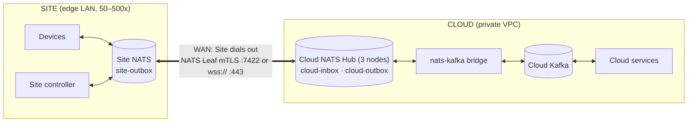
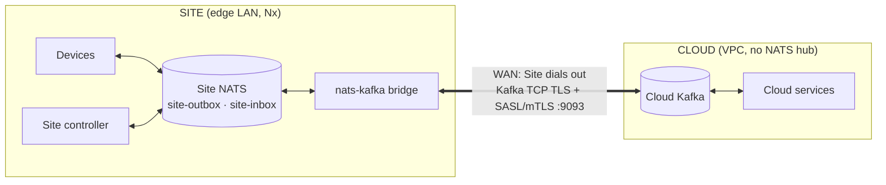
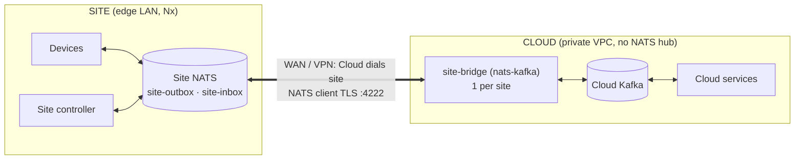
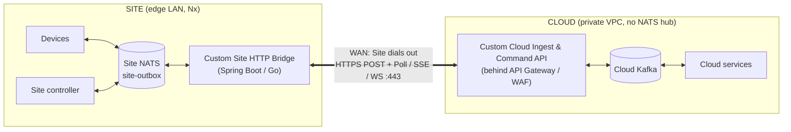

# Pattern Comparison: A vs B vs C

All three patterns in this repository share the same goals:
- **Cloud services** only talk to **Kafka**.
- **Site devices** only talk to their local **NATS** server (local disk
  durability in `<site>-outbox` survives WAN outages and site crashes).
- **Zero custom bridge code** — all three use the official
  [`nats-io/nats-kafka`](https://github.com/nats-io/nats-kafka) image with
  generated config.
- **Same naming & topic rules** ([naming.md](naming.md)).

They differ in **where `nats-kafka` runs**, **whether there is a Cloud NATS
Hub**, and **which side opens the WAN connection**.

## Architecture side by side (Site vs Cloud boundary)

### Pattern A — Cloud NATS Hub + Cloud Bridge ([`pattern-a-cloud-hub/`](../pattern-a-cloud-hub/README.md))

### Pattern B — Site Bridge → Cloud Kafka ([`pattern-b-direct-kafka/`](../pattern-b-direct-kafka/README.md))

### Pattern C — Cloud Bridge → Site NATS ([`pattern-c-cloud-bridge-direct/`](../pattern-c-cloud-bridge-direct/README.md))

### Reference — Custom HTTP Bridge (not built here; see [ADR-0001](adr/0001-site-to-cloud-transport.md))

## What runs where

| Component | Pattern A | Pattern B | Pattern C | Custom HTTP Bridge |
|---|---|---|---|---|
| **Devices & Site controller** | Site | Site | Site | Site |
| **Site NATS** | Site (`site-outbox`) | Site (`site-outbox`, `site-inbox`) | Site (`site-outbox`, `site-inbox`) | Site (`site-outbox`) |
| **Bridge / Gateway** | **Cloud** `nats-kafka` (1 shared) | **Site** `nats-kafka` (1/site) | **Cloud** `nats-kafka` (1/site) | **Both** (custom site agent + custom cloud HTTP API) |
| **Cloud NATS Hub (3 nodes)** | **Cloud** | *(none)* | *(none)* | *(none)* |
| **Cloud Kafka** | **Cloud** (private VPC) | **Cloud** (reachable over WAN) | **Cloud** (private VPC) | **Cloud** (private VPC) |
| **Who dials across WAN?** | **Site → Cloud** | **Site → Cloud** | **Cloud → Site** (needs VPN) | **Site → Cloud** |

## Head-to-head comparison

| Dimension | Pattern A: Cloud NATS Hub | Pattern B: Site Bridge → Kafka | Pattern C: Cloud Bridge → Site NATS | Custom HTTP Bridge |
|---|---|---|---|---|
| **Custom code to write & maintain** | **None** | **None** | **None** | **High** (site agent + cloud ingest/command API, rolled out to all sites) |
| **Cloud footprint** | Kafka + 3-node NATS hub + 1 `nats-kafka` | Kafka only | Kafka + *N* `nats-kafka` (1/site) | Kafka + Cloud HTTP API + DB/store for command queue & acks |
| **Site footprint** | 1 container (`nats-server`) | 2 containers (`nats-server` + `nats-kafka`) | 1 container (`nats-server`) | 2 containers (`nats-server` + custom site bridge) |
| **Works behind NAT (no inbound ports)?** | **Yes** (site dials out) | **Yes** (site dials out) | **No** (cloud dials `<site>:4222` over VPN) | **Yes** (site dials out over HTTPS) |
| **HTTPS-only proxy (`:443`)?** | **Yes** (`wss:// :443`) | **No** | **No** | **Yes** (plain HTTPS) |
| **TLS-inspecting (MITM) proxy + WAF?** | **No** (mTLS breaks under MITM) | **No** | **No** | **Yes** (token/OAuth auth survives TLS inspection) |
| **Cloud Kafka stays private in VPC?** | **Yes** | **No** (brokers exposed to sites) | **Yes** | **Yes** |
| **Ordering, resume, dedupe, backpressure** | **Built-in** (JetStream sourcing + flow control) | **Built-in** (`nats-kafka` + JetStream) | **Built-in** (`nats-kafka` + JetStream) | **You build & test it all** (batching, retry, cursor resume, idempotency, 429/503, command ack/redelivery) |
| **Per-site isolation** | NATS hub accounts (config-enforced) | Kafka ACLs | NATS user per site | Hand-coded auth checks on every API endpoint |
| **Downlink command delivery** | Real-time pull over leaf | Real-time via Kafka consumer | Real-time via Kafka consumer | Polling (latency + empty polls from 500 sites) or custom SSE/WebSocket ack protocol |
| **Site-offline detection** | Built-in `$SYS.ACCOUNT.<site>.DISCONNECT` | Custom / Kafka group liveness | Bridge reconnect logs / `/varz` | Custom heartbeat endpoint + staleness timer |
| **2 Mbps WAN uplink (measured)** | ~400 msg/s (512 B), 1.64 Mbps, 0 loss, 1.4 s cmd latency ([report](load-test-2mbps.md)) | Similar wire ceiling | Similar wire ceiling | Can batch + gzip over HTTP (higher payload density), but at the cost of custom reliability code |
| **Best fit** | 50–500+ sites, restrictive firewalls, strict VPC isolation | Small site count, outbound-only sites, no Cloud NATS | Private site-to-cloud VPN, minimal site ops, private Kafka | TLS-terminating corporate proxies/WAF required, or 3rd-party sites you don't operate |

## Should you build a custom HTTP bridge yourself?

**Usually no — for sites you operate, Pattern A (or C on a private VPN) is a better choice.**

You still need Site NATS (`<site>-outbox`) on the site either way for local
disk durability. Adding a custom HTTP bridge on top means **re-implementing in
your own code** everything JetStream + leaf nodes already give you for free:
ordered batching, crash-safe cursor resume, deduplication beyond short retry
windows, backpressure (`429`/`503`), per-site authorization checks, command
expiry, and a real-time downlink ack/redelivery protocol — and then rolling
out upgrades to every site.

**When a custom HTTP bridge *is* the right call** (detailed in
[ADR-0001](adr/0001-site-to-cloud-transport.md)):
1. **TLS-inspecting (MITM) corporate proxies** sit between sites and the cloud
   (breaking mTLS) and security mandates a WAF / API Gateway with token auth.
2. **Third-party sites** you don't control need a standard REST API contract.
3. **Very low command volume** where polling every few seconds is acceptable
   and you want gzip-batched HTTP uploads over very slow/metered links.

For the full decision records, see
[ADR-0001](adr/0001-site-to-cloud-transport.md) and
[ADR-0003](adr/0003-direct-site-to-kafka-vs-cloud-hub.md).
