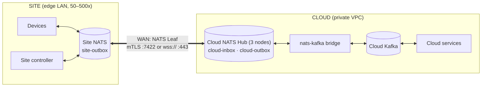
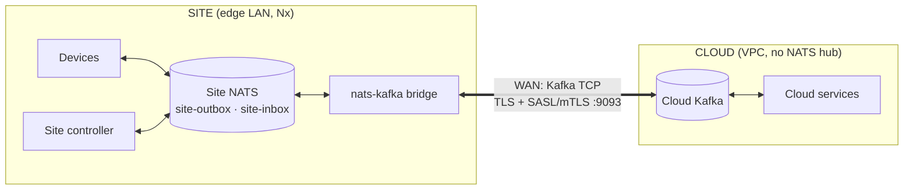

# Pattern Comparison: Cloud NATS Hub vs Direct Site-to-Kafka

Both patterns in this repository share the same goals:
- **Cloud services** only talk to **Kafka**.
- **Site devices** only talk to their local **NATS** server (so local disk
  durability in `<site>-outbox` survives WAN outages and site crashes).
- **Zero custom bridge code** — both use the official
  [`nats-io/nats-kafka`](https://github.com/nats-io/nats-kafka) image with
  generated config.
- **Same naming & topic rules** ([naming.md](naming.md)).

The difference is **where the NATS ↔ Kafka bridge runs**: in the cloud behind
a Cloud NATS Hub (**Pattern A**), or at each site talking straight to Cloud
Kafka (**Pattern B**).

## Architecture side by side (Site vs Cloud boundary)

### Pattern A — Bridge in the Cloud ([`pattern-a-cloud-hub/`](../pattern-a-cloud-hub/README.md))

### Pattern B — Bridge at the Site ([`pattern-b-direct-kafka/`](../pattern-b-direct-kafka/README.md))

## What runs where

| Component | Pattern A | Pattern B |
|---|---|---|
| **Devices & Site controller** | Site | Site |
| **Site NATS (`site-outbox`)** | Site | Site (`site-outbox` + `site-inbox`) |
| **`nats-kafka` bridge** | **Cloud** (1 shared deployment) | **Site** (1 per site) |
| **Cloud NATS Hub (3 nodes)** | **Cloud** | *(none)* |
| **Cloud Kafka & Cloud services** | **Cloud** (private VPC) | **Cloud** (reachable from sites over WAN) |
| **Protocol crossing the WAN** | **NATS Leaf** (`tls:// :7422` or `wss:// :443`) | **Kafka binary protocol** (`:9093`) |

## Head-to-head comparison

| Dimension | Pattern A: Cloud NATS Hub | Pattern B: Direct Site-to-Kafka |
|---|---|---|
| **Cloud footprint** | Kafka + 3-node NATS hub + 1 `nats-kafka` | Kafka only |
| **Site footprint** | 1 container (`nats-server`) | 2 containers (`nats-server` + `nats-kafka`) |
| **WAN protocol** | Single outbound NATS leaf (`tls:// :7422` or `wss:// :443`) | Direct Kafka binary protocol to every broker (`:9093`) |
| **HTTPS-only proxy support** | **Yes** (`wss:// :443` through CONNECT proxy) | **No** (Kafka protocol can't traverse HTTP proxies) |
| **Kafka network exposure** | **Private** inside cloud VPC | Must be reachable from every site over WAN (or via VPN/proxy) |
| **Per-site isolation** | Per-site mTLS cert → isolated NATS hub account | Per-site Kafka mTLS/SASL credentials + Kafka ACLs |
| **Site-offline detection** | Built-in `$SYS.ACCOUNT.<site>.DISCONNECT` (~60–75 s) | Must build heartbeats or monitor Kafka group membership |
| **Stale command expiry** | `Nats-TTL` deletes expired commands in `cloud-outbox` before WAN transfer | Commands wait in Kafka; site controller must check `expiresAt` in payload |
| **2 Mbps WAN uplink (measured)** | ~400 msg/s (512 B), 1.64 Mbps effective, 0 loss, 1.4 s command latency during saturation ([full report](load-test-2mbps.md)) | Similar wire ceiling; Kafka batching can slightly reduce framing overhead |
| **Best fit** | 50–500+ sites, restrictive firewalls, strict VPC isolation, minimal site ops | Small site count on private VPN to cloud VPC, want to avoid running Cloud NATS |

For the full decision record, see
[ADR-0003](adr/0003-direct-site-to-kafka-vs-cloud-hub.md).
