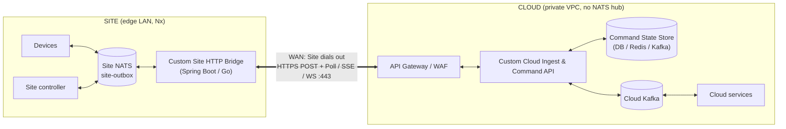
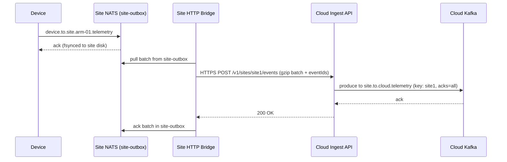
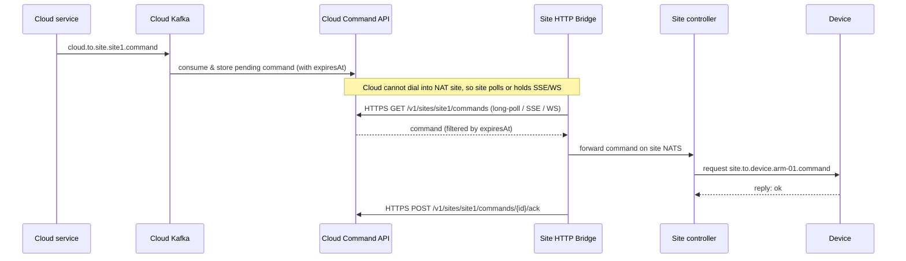

# Custom HTTP Bridge (Site NATS ↔ HTTPS ↔ Cloud Kafka)

Should you build your own HTTP bridge instead of using **Pattern A** (Cloud
NATS Hub + Leaf), **Pattern B** (Site Bridge → Cloud Kafka), or **Pattern C**
(Cloud Bridge → Site NATS)?

This document lays out what a custom HTTP bridge looks like, what you have to
build and operate if you choose it, and when it is (or isn't) the right call.
See also [docs/comparison.md](comparison.md) and
[ADR-0001](adr/0001-site-to-cloud-transport.md).

## Architecture (Site vs Cloud boundary)

## Up & Down flows

### Up: device → Cloud Kafka

### Down: Cloud Kafka → device

## What you have to build & own

Even with an HTTP bridge, you **still** run `nats-server` (`site-outbox`) at
every site for local disk durability. On top of it, you now write, test,
version, and roll out **two custom services**:

| Responsibility | In Pattern A (Leaf + `nats-kafka`) | In a Custom HTTP Bridge |
|---|---|---|
| **Uplink resume & ordering** | Built into JetStream stream sourcing (measured across outages, site `kill -9`, leader loss) | You implement: pull batch, POST, retry with backoff, single in-flight batch per site to keep order, ack only on `2xx` |
| **Deduplication** | Built into stream sequence tracking + `Nats-Msg-Id` | Every lost HTTP response triggers a retry → you need idempotency keys + dedupe logic at ingest or downstream |
| **Backpressure** | Built-in JetStream flow control (`$JS.FC`) | You implement HTTP `429` / `503` + `Retry-After` handling in the site bridge |
| **Downlink delivery & acks** | Durable pull consumer over leaf (real-time, explicit ack, `ack_wait` redelivery) | You implement polling (latency + empty polls from 500 sites) or a custom SSE/WebSocket ack & redelivery protocol + command state store |
| **Command expiry** | Built-in `Nats-TTL` deletes expired commands in `cloud-outbox` | You filter `expiresAt` in the Command API and in the site controller |
| **Per-site authorization** | Hub enforces isolated per-site NATS accounts by config | Every HTTP endpoint must verify caller identity matches `{siteId}` in the path; one missed check is a cross-site leak |
| **Site-offline signal** | Built-in `$SYS.ACCOUNT.<site>.DISCONNECT` (~60–75 s) | You build a heartbeat endpoint + staleness detector |
| **Fleet rollouts** | Config-only at sites (`nats-server`) | Build, test, version, and upgrade custom bridge code on 50–500 sites |

## Verdict: Good idea or not?

### Usually **No** (for sites you operate)

For sites you own and operate, **Pattern A** (or **Pattern C** if you have a
site-to-cloud VPN) is the stronger default. A custom HTTP bridge does not
remove local NATS from the site — it adds two custom distributed-systems
services whose failure modes (stuck cursors, silent retries, redelivery
reordering, missed auth checks) are the exact bugs NATS JetStream already
solved and tested.

### When a custom HTTP bridge **is** the right call

1. **TLS-inspecting (MITM) corporate proxies** sit between sites and the cloud
   (which break mTLS client certificates) and security mandates a WAF / API
   Gateway with OAuth/JWT token auth on every inbound request.
2. **Third-party sites** you do not operate need a standard REST/OpenAPI
   contract rather than running NATS leaf config.
3. **Severely bandwidth-constrained / metered links** where gzip-compressed
   HTTP batches significantly reduce WAN bytes and polling latency for
   commands is acceptable.

> **Hybrid note:** If only a few partner/third-party sites require HTTP, run a
> small HTTP ingest/command gateway at the cloud edge *just for those sites*
> while keeping your own fleet on Pattern A.
