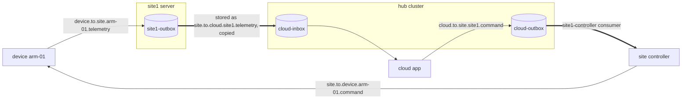
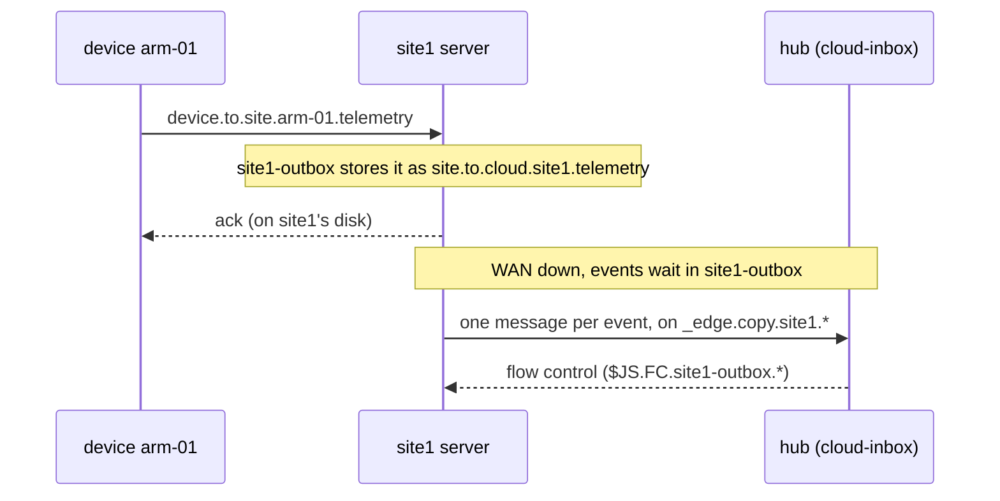
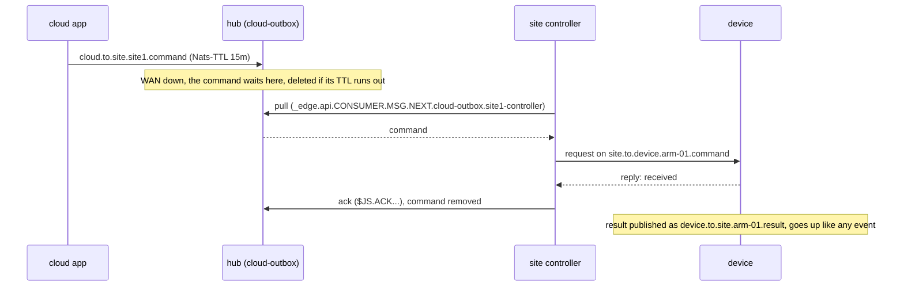

# How it works

- [Pieces](#pieces)
- [Up: device → cloud](#up-device--cloud)
- [Down: cloud → device](#down-cloud--device)
- [Delivery speed](#delivery-speed)
- [Security](#security)
- [Failures](#failures)
- [Operating it](#operating-it)
- [Tests](#tests)

Names of subjects, streams, users and so on are defined in
[naming.md](naming.md). Versions: nats-server 2.12.5, nats.go 1.46.1.
References like `server/stream.go` point to the nats-server source.

## Pieces

| Piece | Runs | Does |
|---|---|---|
| Device | site | publishes `device.to.site.<device>.<type>`, receives `site.to.device.<device>.command` |
| Site controller (your app) | site | pulls the site's commands from the cloud, decides which device acts |
| Site server (`site1`) | site, one per site | stores events in `site1-outbox` until the cloud has them |
| Hub cluster (`cloud-hub-1..3`) | cloud, 3 nodes, streams replicated 3× | `cloud-inbox` (events from all sites), `cloud-outbox` (commands) |
| Cloud app | cloud | reads `site.to.cloud.>`, publishes `cloud.to.site.<site>.command` |

Each site server connects **out** to the hub as a leaf node (TLS on 7422, or
`wss://` on 443), so sites need no inbound port. Each side runs its own
JetStream domain (`cloud`, `site1`, …), which lets the hub manage the copy of a
site's stream over that one connection.

## Up: device → cloud

1. The device publishes with JetStream. `site1-outbox` captures
   `device.to.site.*.telemetry`, `.health` and `.result`, and its subject
   transform stores each as `site.to.cloud.site1.<type>`, dropping the device
   id. The ack comes from the site's own server, so publishing works with the
   WAN down.
2. A type not on that list (say `device.to.site.arm-01.debug`) is stored
   nowhere and never leaves the site.
3. `cloud-inbox` lists each site's outbox as a *source*. After an outage the
   copy resumes from the last event the cloud stored. Order per site is kept,
   and each event is stored once.

The device id travels in the payload. The cloud doesn't need it, but it's
there if someone ever does.

`site1-outbox` uses `discard: new`. If the site's disk fills during a very
long outage, publishes **fail** (the device sees an error) rather than old
unsent events being dropped. Size `max_bytes` as event rate × longest outage.

## Down: cloud → device

- The cloud addresses a **site**, never a device. Choosing the device is the
  site controller's job (scheduling, idle devices, retries). A forwarding rule
  can't do it, because rules only rewrite subjects.
- `cloud-outbox` is a work queue: an acked command is deleted. The controller
  acks only after the device confirmed receipt, so a controller crash before
  that means redelivery, not loss.
- Each command carries a TTL (`Nats-TTL`). If it runs out while the site is
  unreachable, the command is deleted in the cloud and never shipped.
- The controller reaches its consumer through `_edge.api.*`, not the domain
  prefix `$JS.cloud.API.*`: the hub answers `$JS.cloud.API.*` itself in every
  account, before an import could route it.

## Delivery speed

**Up is event by event.** The copy is a push consumer that sends one NATS
message per stored event. `TestUplinkCopiesEventByEvent` measures it on the
site's leaf connection: 2,000 messages for 2,000 events. Up to about 2 MB can
be in flight before the site waits for a flow-control reply
(`JsFlowControlMaxPending` 32 MB ÷ 16, `server/consumer.go`).

**The up copy has no speed setting.** A stream source has no rate field
(`StreamSource`, `server/stream.go`), so the copy runs as fast as the link and
flow control allow. To limit it you would have to do one of these:
- shape traffic on the site's WAN link (router QoS or `tc`), which slows commands too;
- split the outbox into a small priority stream (health, results) and a bulk
  stream (telemetry), each copied separately, so a telemetry backlog doesn't
  delay the important events;
- replace the built-in copy with your own copier that reads the outbox through
  a consumer with `rate_limit_bps`, and handles resume and de-duplication itself.

**Down is pulled in batches, one message and one ack per command.** The
controller sets the pace:
- batch size and how often it pulls;
- `max_ack_pending` on `<site>-controller` (100 here): the most commands
  delivered but not yet acked;
- `ack_wait` (30 s): after this an unacked command is redelivered.

`rate_limit_bps` can't be used: the server rejects it on pull consumers
(`server/consumer.go`).

## Security

**Identity: one certificate per site.** The hub's leaf and WebSocket listeners
use `verify_and_map`, so a site's certificate subject (`CN=site1,O=fleet`) is
its user name. There are no shared passwords, and revoking one site's
certificate touches no other site.

**Isolation: one hub account per site.** A site's leaf logs in to its own
account, which sees only what it imports. `scripts/generate.sh` generates,
per site:

| Between | What crosses | Why |
|---|---|---|
| `site1` → `cloud` | `$JS.site1.API.>`, `$JS.FC.site1-outbox.>`, `_edge.copy.site1.>` | the cloud copies site1's outbox |
| `cloud` → `site1` | `MSG.NEXT` / `INFO` on `site1-controller`, `$JS.ACK.cloud-outbox.site1-controller.>` | site1 pulls and acks its own commands |

Nothing else crosses, so a site can't read another site's commands or see any
of its traffic (`TestSitesAreIsolated`).

**Roles on each hop.** Each user may use only its own hop
(`TestRolesUseOnlyTheirHop`):
- `device` publishes `device.to.site.>`, receives `site.to.device.>`, and may
  reply to a command it received (`allow_responses`) but publish nothing else.
- `site-controller` publishes `site.to.device.>` and pulls its own consumer.
- `cloud-app` publishes `cloud.to.site.>` and uses the JetStream API.

**Cluster routes.** Sites and hubs share one CA. Routes use
`verify_cert_and_check_known_urls`: a peer's certificate must carry a DNS name
matching a configured route, and site certificates carry none.

**Load balancer.** If one is in front of the hubs, it must pass TLS through,
not terminate it, or the hub can't see the site's certificate.

## Failures

| What happens | Result | Test |
|---|---|---|
| WAN link down | events acked on the site; arrive in order when the link returns | `TestUplinkSurvivesWANOutage` |
| Command TTL runs out during an outage | deleted in the cloud, never delivered | `TestStaleCommandsExpireInCloud` |
| Site server killed mid-outage | nothing acked is lost | `TestSiteServerCrashDuringOutage` |
| Hub node leading `cloud-inbox` killed mid catch-up | another node takes over, no loss, queued command still delivered | `TestHubLeaderLossDuringCatchUp` |
| Site goes silent | hub emits `$SYS.ACCOUNT.<site>.DISCONNECT` | `TestSiteOfflineEvent` |

Timing to expect:
- **Dead link detection:** `ping_interval: 20s`, `ping_max: 2` notice a silent
  link in about a minute (61–74 s in `TestSiteOfflineEvent`). The default
  (2m × 2) takes several minutes.
- **Catch-up can start late.** A copy that kept failing retries with a growing
  delay, capped at 2 minutes (`retryMaximum`, `server/stream.go`). The leaf may
  reconnect in seconds and the copy start a minute or two later. Nothing is
  lost, and commands aren't affected.
- **Resends after a cut.** Until pings notice a dead link, the site keeps
  writing the copy into the dead connection (up to the 2 MB window). The copy
  then restarts from the cloud's last stored event, so some events cross the
  link twice. The cloud stores them once.
- **After a hub node dies,** creating a short-lived (R1) consumer can time out
  for a few minutes, because it may be placed on the dead node. Durable,
  replicated consumers keep working. In cloud apps, prefer durable consumers,
  or retry short-lived ones with a short timeout.

**Power loss.** `sync_interval: always` on sites flushes every write to disk.
The default flushes every 2 minutes, so a power cut could lose up to 2 minutes
of events a device already saw acked.

## Operating it

**Add a site** (`site3`):
1. Add `site3` to `SITES` in the `Makefile`.
2. In `compose.yaml`, copy the `site1` service and its network, and add
   `site3` to `SITES` of the `setup` service.
3. `make down && rm -rf certs && make up`. This regenerates the certificates
   and everything in `config/generated/` (accounts, site config, outbox,
   controller consumer, the `cloud-inbox` source).

**Watch:**
- `$SYS.ACCOUNT.<site>.DISCONNECT`: a site went offline.
- `cloud-inbox` source info, per site: *last seen* growing means that site's
  copy is stuck. Don't alert on *lag*; it reads 0 while a site is offline.
- `cloud-outbox`: pending commands and their age, per consumer.
- Each `<site>-outbox`'s size against `max_bytes`.

**Silent failures to know about.** A request outside a site's account gets
`no responders`, and nothing is logged on the hub. A missing import or export
stops the copy without an error. Generate accounts with the script, never by
hand, and alert on *last seen*.

## Tests

`make test` runs `e2e/` against the stack from `make up`. The tests cut WAN
links with `docker network disconnect` and kill containers, so they run one at
a time.

| Test | Checks |
|---|---|
| `TestForwardUpDeviceToCloud` | each up type arrives as `site.to.cloud.<site>.<type>` without device ids; other types stay on the site |
| `TestForwardDownCloudToDevice` | command reaches the device via the controller; result comes back up; ack clears it |
| `TestRolesUseOnlyTheirHop` | device, controller and cloud app are refused the other hops |
| `TestNamingConvention` | every subject, stream and consumer name in `config/` follows [naming.md](naming.md) |
| `TestUplinkSurvivesWANOutage` | publish during an outage, catch up in order |
| `TestStaleCommandsExpireInCloud` | TTL-expired command never delivered, fresh one delivered |
| `TestSiteServerCrashDuringOutage` | `kill -9` of a site server loses nothing |
| `TestHubLeaderLossDuringCatchUp` | 20,000-event catch-up survives losing the stream leader |
| `TestSitesAreIsolated` | no cross-site consumer access, no cross-site traffic |
| `TestUplinkCopiesEventByEvent` | one leaf message per event, each stored once, in order |
| `TestSiteOfflineEvent` | hub reports the site's DISCONNECT / CONNECT with its cert identity |
