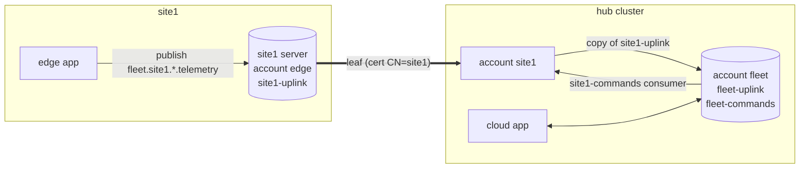
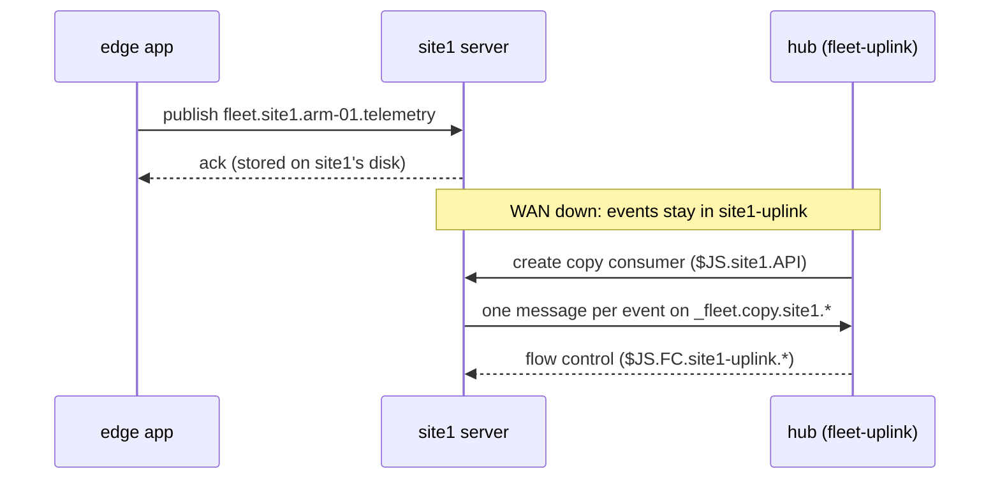
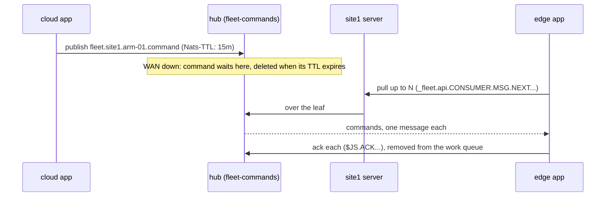

# How it works

- [Pieces](#pieces)
- [Subjects](#subjects)
- [Uplink: site → cloud](#uplink-site--cloud)
- [Commands: cloud → site](#commands-cloud--site)
- [Delivery speed](#delivery-speed)
- [Security](#security)
- [Failures](#failures)
- [Operating it](#operating-it)
- [Tests](#tests)

Versions: nats-server 2.12.5, nats.go 1.46.1. References like
`server/stream.go` point to the nats-server source at that version.

## Pieces

| Piece | Runs | Holds |
|---|---|---|
| Site server (`site1`, `site2`) | one per site, on the site LAN | stream `<site>-uplink`: events not yet in the cloud |
| Hub cluster (`cloud-hub-1..3`) | cloud, 3 nodes, every stream replicated 3× | `fleet-uplink`: all sites' events; `fleet-commands`: queued commands |
| Edge app | site | publishes events, pulls commands |
| Cloud app | cloud | reads events, publishes commands |

Each site server connects **out** to the hub as a leaf node (TLS, port 7422,
or `wss://` on 443). Sites need no inbound port, so they work behind NAT.

Each side runs its own JetStream *domain* (`cloud`, `site1`, `site2`), so the
hub can manage streams on a site, and a site can reach a consumer in the
cloud, over the one leaf connection.

## Subjects

Rules:
- Lowercase, dot-separated, general to specific: `fleet.<site>.<robot>.<type>`.
- Site and robot ids use `a-z`, `0-9` and `-`, never dots (a dot starts a new token).
- `_fleet.*` is plumbing between servers. Applications never use it.
- `$JS.*`, `$SYS.*` and `_INBOX.*` belong to NATS and can't be renamed.

### Application subjects

| Subject | Direction | Publisher | Stored in |
|---|---|---|---|
| `fleet.<site>.<robot>.telemetry` | site → cloud | edge app | `<site>-uplink`, then `fleet-uplink` |
| `fleet.<site>.<robot>.health` | site → cloud | edge app | `<site>-uplink`, then `fleet-uplink` |
| `fleet.<site>.<robot>.command` | cloud → site | cloud app | `fleet-commands` |
| `fleet.<site>.<robot>.command.result` | site → cloud | edge app | `<site>-uplink`, then `fleet-uplink` |

Useful wildcards: `fleet.site1.>` (everything about site1),
`fleet.site1.arm-01.>` (one robot), `fleet.*.*.telemetry` (all telemetry).

### Plumbing subjects (ours)

| Subject | Used for |
|---|---|
| `_fleet.api.CONSUMER.MSG.NEXT.fleet-commands.<site>-commands` | the site pulls its commands from the cloud |
| `_fleet.api.CONSUMER.INFO.fleet-commands.<site>-commands` | the site looks up its command consumer |
| `_fleet.copy.<site>.>` | the copy of `<site>-uplink` travelling to `fleet-uplink` |

The site reaches its consumer through `_fleet.api.*` rather than the domain
prefix `$JS.cloud.API.*`. The hub answers `$JS.cloud.API.*` itself in every
account ("JetStream not enabled for account"), before an import can route it.

### NATS-owned subjects you will see

| Subject | Meaning |
|---|---|
| `$JS.<site>.API.>` | JetStream API of a site's domain; the hub uses it to run the copy |
| `$JS.FC.<site>-uplink.>` | flow-control replies for that copy |
| `$JS.ACK.fleet-commands.<site>-commands.>` | the site acking a command |
| `$SYS.ACCOUNT.<site>.CONNECT` / `.DISCONNECT` | a site's leaf connected / disconnected |
| `_INBOX.>` | request/reply inboxes of the client libraries |

## Uplink: site → cloud

1. The edge app publishes with JetStream. The ack comes from the **site's**
   server once the event is in `site1-uplink`, so publishing works with the WAN down.
2. `fleet-uplink` lists each site stream as a *source*. The hub keeps a push
   consumer on the site stream and stores what arrives.
3. After an outage the copy resumes from the last event the cloud stored.
   Order per site is kept, and the cloud stores each event once.

`site1-uplink` uses `discard: new`. If the site disk fills during a very long
outage, publishes **fail** (the app sees an error) rather than old unsent
events being dropped. Size `max_bytes` as uplink rate × longest outage.

## Commands: cloud → site

- `fleet-commands` is a work queue: an acked command is deleted.
- Each site has one durable consumer, `<site>-commands`, filtered to
  `fleet.<site>.*.command`.
- The cloud app sets a TTL per command (`Nats-TTL` header, stream has
  `allow_msg_ttl`). A command whose TTL runs out is deleted in the cloud and
  never shipped. Keep an `expiresAt` check in the edge app too, for time a
  command spends at the site after delivery.

## Delivery speed

**Uplink is event by event.** The copy is a push consumer that sends one NATS
message per stored event. `TestUplinkCopiesEventByEvent` measures it on the
site's leaf connection: 2,001 messages (114 bytes each) for 2,000 events.
Up to about 2 MB can be in flight before the site waits for a flow-control
reply (`JsFlowControlMaxPending` 32 MB ÷ 16, `server/consumer.go`).

**The uplink copy has no speed setting.** A stream source has no rate field
(`StreamSource`, `server/stream.go`), so the copy runs as fast as the link and
flow control allow. To limit it you would have to do one of these:
- shape traffic on the site's WAN link (router QoS or `tc`), which also slows commands;
- split the uplink into a small priority stream (health, command results) and
  a bulk stream (telemetry), each copied separately, so a telemetry backlog
  doesn't delay the important events;
- replace the built-in copy with your own copier that reads the site stream
  through a consumer with `rate_limit_bps`, and handles resume and
  de-duplication itself.

**Commands are pulled in batches, but each one is its own message with its
own ack.** You control the pace from the site:
- batch size and how often the edge app pulls;
- `max_ack_pending` on `<site>-commands` (100 here), the most commands
  delivered but not yet acked;
- `ack_wait` (30 s here), after which an unacked command is redelivered.

`rate_limit_bps` can't be used: the server rejects it on pull consumers
(`server/consumer.go`).

## Security

**Identity: one certificate per site.** The hub's leaf and WebSocket
listeners use `verify_and_map`, so a site's certificate subject
(`CN=site1,O=fleet`) is its user name. There are no shared passwords, and
revoking one site's certificate touches no other site.

**Isolation: one hub account per site.** A site's leaf logs in to its own
account, which can see only what it imports. `scripts/gen-hub-accounts.sh`
generates exactly this per site:

| Between | What crosses | Why |
|---|---|---|
| `site1` → `fleet` | `$JS.site1.API.>`, `$JS.FC.site1-uplink.>`, `_fleet.copy.site1.>` | the cloud copies site1's uplink |
| `fleet` → `site1` | `MSG.NEXT` / `INFO` on `site1-commands`, `$JS.ACK.fleet-commands.site1-commands.>` | site1 pulls and acks its own commands |

Nothing else crosses, so a site can't read another site's commands or see
any of its traffic (`TestSitesAreIsolated`).

**Cluster routes.** Sites and hubs share one CA. Routes use
`verify_cert_and_check_known_urls`: a peer's certificate must carry a DNS
name matching a configured route, and site certificates carry none.

**On the site.** `edge-app` may publish under `fleet.<site>.>` except
`fleet.<site>.*.command`; commands only ever come from the cloud.
`site-ops` exists only to create the site stream.

**Load balancer.** If you put one in front of the hubs, it must pass TLS
through, not terminate it, or the hub can't see the site's certificate.

## Failures

| What happens | Result | Test |
|---|---|---|
| WAN link down | events acked on the site; arrive in order when the link returns | `TestUplinkSurvivesWANOutage` |
| Command TTL runs out during an outage | deleted in the cloud, never delivered | `TestStaleCommandsExpireInCloud` |
| Site server killed mid-outage | nothing acked is lost | `TestSiteServerCrashDuringOutage` |
| Hub node leading `fleet-uplink` killed mid catch-up | another node takes over, no loss, queued command still delivered | `TestHubLeaderLossDuringCatchUp` |
| Site goes silent | hub emits `$SYS.ACCOUNT.<site>.DISCONNECT` | `TestSiteOfflineEvent` |

Timing to expect:
- **Dead link detection:** `ping_interval: 20s`, `ping_max: 2` notice a
  silent link in about a minute (61–74 s in `TestSiteOfflineEvent`). The default
  (2m × 2) takes several minutes.
- **Catch-up can start late.** A copy that kept failing retries with a growing
  delay, capped at 2 minutes (`retryMaximum`, `server/stream.go`). After a
  long outage the leaf may reconnect in seconds and the copy start a minute or
  two later. Nothing is lost, and commands are not affected.
- **Resends after a cut.** Until pings notice a dead link, the site keeps
  writing the copy into the dead connection (up to the 2 MB window). The copy
  then restarts from the cloud's last stored event, so some events cross the
  link twice. The cloud stores them once.
- **After a hub node dies,** creating a short-lived (R1) consumer can time out
  for a few minutes, because it may be placed on the dead node. Durable,
  replicated consumers, like the ones in this design, keep working. In cloud
  apps, prefer durable consumers, or retry short-lived ones with a short timeout.

**Power loss.** `sync_interval: always` on sites flushes every write to disk.
The default flushes every 2 minutes, so a power cut could lose up to 2 minutes
of events the app already saw acked.

## Operating it

**Add a site** (`site3`):
1. Add `site3` to `SITES` in the `Makefile`, and copy `config/site1.conf` to
   `config/site3.conf` with `site1` replaced by `site3`.
2. Add a service and network for it in `compose.yaml` (copy `site1`), and add
   it to `SITES` in `scripts/setup.sh`.
3. Copy `config/streams/site1-uplink.json` and `site1-commands.json` for
   site3, and add a `site3-uplink` source with deliver prefix
   `_fleet.copy.site3` to `fleet-uplink.json`.
4. `make down && rm -rf certs && make up` regenerates the certificates and
   the hub accounts (they rebuild whenever the `Makefile` changes).

**Watch:**
- `$SYS.ACCOUNT.<site>.DISCONNECT`: a site went offline.
- `fleet-uplink` source info, per site: *last seen* growing means that site's
  copy is stuck. Don't alert on *lag*; it reads 0 while a site is offline.
- `fleet-commands`: pending commands and their age, per consumer.
- Each site stream's size against `max_bytes`.

**Silent failures to know about.** A request outside a site's account gets
`no responders` and nothing is logged on the hub. A missing import or export
stops the copy without an error. Generate accounts with the script, never by
hand, and alert on *last seen*.

## Tests

`make test` runs `e2e/` against the stack from `make up`. The tests cut WAN
links with `docker network disconnect` and kill containers, so they run one at
a time.

| Test | Checks |
|---|---|
| `TestUplinkSurvivesWANOutage` | publish during an outage, catch up in order |
| `TestStaleCommandsExpireInCloud` | TTL-expired command never delivered, fresh one delivered |
| `TestSitesAreIsolated` | no cross-site consumer access, no command injection, no cross-site traffic |
| `TestSiteServerCrashDuringOutage` | `kill -9` of a site server loses nothing |
| `TestHubLeaderLossDuringCatchUp` | 20,000-event catch-up survives losing the stream leader |
| `TestUplinkCopiesEventByEvent` | one leaf message per event, each stored once, in order |
| `TestSiteOfflineEvent` | hub reports the site's DISCONNECT / CONNECT with its cert identity |
