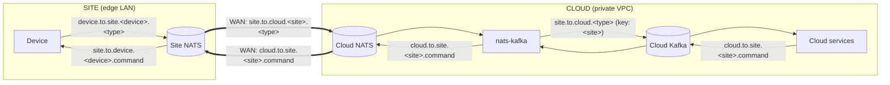

# Naming

One rule set for everything that has a name. `TestNamingConvention`
([pattern-a-cloud-hub/e2e/naming_test.go](../pattern-a-cloud-hub/e2e/naming_test.go))
checks every subject, stream and consumer name in `config/` against it;
`TestKafkaTopicNames`
([pattern-a-cloud-hub/e2e/kafka_test.go](../pattern-a-cloud-hub/e2e/kafka_test.go))
checks every Kafka topic.

## The model

The cloud talks to **sites**. A site talks to its **devices**. The cloud never
needs to know a device, so device ids never cross the WAN. Inside the cloud,
cloud services talk to Kafka, and `nats-io/nats-kafka` bridges Kafka and the
cloud NATS hub.

## NATS subjects: `<from>.to.<to>.<id>.<type>`

| Hop | Subject | Example |
|---|---|---|
| Cloud → site | `cloud.to.site.<site>.<type>` | `cloud.to.site.site1.command` |
| Site → cloud | `site.to.cloud.<site>.<type>` | `site.to.cloud.site1.telemetry` |
| Site → device | `site.to.device.<device>.<type>` | `site.to.device.arm-01.command` |
| Device → site | `device.to.site.<device>.<type>` | `device.to.site.arm-01.telemetry` |

`<id>` is the side that isn't fixed by the hop: the site on the WAN hops, the
device on the local hops. Every subject has exactly five tokens.

### Types

| Type | Direction | Meaning |
|---|---|---|
| `telemetry` | up | measurements a device reports |
| `health` | up | device status (alive, faults) |
| `result` | up | outcome of a command |
| `command` | down | something to do |

A new type is added here, to `hops` in `e2e/naming_test.go`, and (for up types)
to `scripts/generate.sh` and `UP_TYPES` in `compose.yaml` before anyone uses it.

### Ids

- Site and device ids: lowercase `a-z`, `0-9` and `-`, starting with a letter
  or digit (`site1`, `arm-01`). Never a dot, because a dot starts a new token.
- The same site id is used everywhere: subjects, Kafka command topic, hub
  account, JetStream domain, server name, certificate CN, and stream names.

### What never goes in a subject

- Message, command or trace ids: use headers (`Nats-Msg-Id`, `Command-Id`).
- Schema versions: use a header (`Schema`) or the payload.
- Environment (`prod`, `dev`): use separate clusters and accounts.
- Device ids on the WAN hops or in Kafka topic/key names: put them in the
  payload if the cloud ever needs them.

### Wildcards

| Want | Use |
|---|---|
| Everything any site sends to the cloud | `site.to.cloud.>` |
| One site's telemetry | `site.to.cloud.site1.telemetry` |
| All sites' telemetry (used by `nats-kafka`) | `site.to.cloud.*.telemetry` |
| Everything the cloud sends to `site1` | `cloud.to.site.site1.>` |
| Everything one device sends | `device.to.site.arm-01.>` |

Rules and permissions always start with the full hop (`site.to.cloud.>`), never
a shorter prefix such as `site.>`, which would match two hops.

### Reserved prefixes

| Prefix | Owner | Used for |
|---|---|---|
| `_edge.api.*` | this project | a site controller reaching its consumer in the cloud |
| `_edge.copy.<site>.*` | this project | the copy of `<site>-outbox` into `cloud-inbox` |
| `$JS.*`, `$SYS.*`, `$KV.*`, `$O.*`, `_INBOX.*` | NATS | JetStream API, acks, flow control, system events, replies |

Applications publish only on the four hops. Don't create subjects under any
reserved prefix.

## Forwarding rules

| Direction | Rule | Where |
|---|---|---|
| Down | Kafka `cloud.to.site.<site>.command` → NATS `cloud.to.site.<site>.command` | `nats-kafka` (`KafkaToJetStream`, one connector per site) |
| Down | `cloud.to.site.<site>.command` → `<site>-controller` consumer | filter on the consumer |
| Down | command → `site.to.device.<device>.command` | the site controller (application) chooses the device |
| Up | `device.to.site.<device>.<type>` → `site.to.cloud.<site>.<type>` for `telemetry`, `health`, `result` | subject transform on `<site>-outbox` |
| Up | `<site>-outbox` → `cloud-inbox` | source on `cloud-inbox` |
| Up | NATS `site.to.cloud.<site>.<type>` → Kafka `site.to.cloud.<type>`, key `<site>` | `nats-kafka` (`JetStreamToKafka`, one connector per type) |

Down needs a site controller because the cloud doesn't name the device: a rule
can only rewrite subjects, it can't decide which device acts.

## Kafka

Kafka lives only in the cloud. Sites never connect to it. Topics are created by
`scripts/setup-kafka.sh` (`KAFKA_AUTO_CREATE_TOPICS_ENABLE=false`).

| Topic | Written by | Read by | Partitions | Key | Holds |
|---|---|---|---|---|---|
| `cloud.to.site.<site>.command` | cloud services | `nats-kafka` (group `kafka-bridge`) | 1 (keeps site commands ordered) | `<site>` (optional) | commands for one site |
| `site.to.cloud.telemetry` | `nats-kafka` | cloud services | 6 (parallel across sites) | `<site>` | telemetry from all sites |
| `site.to.cloud.health` | `nats-kafka` | cloud services | 6 | `<site>` | health from all sites |
| `site.to.cloud.result` | `nats-kafka` | cloud services | 6 | `<site>` | command results from all sites |

- **Why per-site command topics?** `nats-io/nats-kafka` maps each
  `KafkaToJetStream` connector to one static NATS subject. One topic per site
  keeps the bridge 100% config-driven (generated by `scripts/generate.sh`) and
  prevents commands for an unknown site from ever being accepted by Kafka
  (since auto-topic creation is off). See [ADR-0002](adr/0002-kafka-nats-bridge.md).
- **Why one topic per type on the way up?** `JetStreamToKafka` binds to
  `cloud-inbox` with one durable connector per `(site, type)`
  (`site.to.cloud.<site>.<type>`, `keytype: "fixed"`, `keyvalue: "<site>"`).
  Using `<site>` as the Kafka key keeps all events for one site on a single
  partition, in order, while isolating each site's consumer lag.
- **Payloads and headers** pass through `nats-kafka` unchanged. Cloud services
  may include `Nats-Msg-Id` (deduplication), `Nats-TTL` (e.g. `15m`), `siteId`,
  and `Schema` headers on Kafka commands.

## Headers

NATS headers are `Title-Case`, documented here before use. Never invent a
header starting with `Nats-`; NATS reserves that prefix.

| Header | Set by | Meaning |
|---|---|---|
| `Nats-Msg-Id` | publisher | event or command id; JetStream drops duplicates with the same id |
| `Nats-TTL` | cloud service | how long a command may wait in `cloud-outbox` before it is deleted |
| `Command-Id` | site controller, device | the command a result belongs to (optional; also in the payload) |
| `Schema` | publisher | payload schema name and version, e.g. `telemetry/v1` (optional) |
| `siteId` | cloud service (optional) | site id metadata on Kafka commands (passed through by `nats-kafka`) |

## JetStream

| Kind | Pattern | Names |
|---|---|---|
| Stream | `<place>-inbox` / `<place>-outbox`, named from where it lives | `site1-outbox`, `cloud-inbox`, `cloud-outbox` |
| Consumer | `<reader>-<role>` | `site1-controller` (on `cloud-outbox` or `<site>-inbox`), `kafka-bridge-<site>-<type>` (created by `nats-kafka`) |

| Stream | Lives in | Holds |
|---|---|---|
| `<site>-outbox` | site | device events waiting to go to the cloud |
| `cloud-inbox` | cloud | events from all sites |
| `cloud-outbox` | cloud | commands for all sites |

Stream and consumer names can't contain dots, so they use `-`.

## Servers, accounts, users, certificates

| Thing | Names |
|---|---|
| Hub servers | `cloud-hub-1`, `cloud-hub-2`, `cloud-hub-3`; cluster `cloud`; DNS name for sites `cloud-hub` |
| Site servers | the site id: `site1`, `site2` |
| Kafka | broker `kafka`; consumer group `kafka-bridge` |
| Bridge | container `kafka-bridge` (`natsio/nats-kafka:1.4.2`) |
| JetStream domains | `cloud`; the site id on each site |
| Hub accounts | `cloud`, one per site (`site1`, …), `system` |
| Site accounts | `site` (everything on the site LAN), `system` |
| Users, by role | `cloud-app`, `kafka-bridge`, `site-controller`, `device`, `site-ops`, `sys` |
| Site certificate | `CN=<site>,O=fleet`, which is also its hub user |
| Hub certificate | DNS names `cloud-hub`, `cloud-hub-1..3` |

## Who may use what

| User | Publish | Subscribe |
|---|---|---|
| `device` | `device.to.site.>`, plus replies to commands it received | `site.to.device.>` |
| `site-controller` | `site.to.device.>`, its own consumer on `cloud-outbox` | `device.to.site.>` |
| `kafka-bridge` | `cloud.to.site.>`, `cloud-inbox` consumer API & acks | replies (`_INBOX.>`) |
| `cloud-app` | `cloud.to.site.>`, JetStream API | replies (`_INBOX.>`) |
| site's hub account | only `site.to.cloud.<site>.*` (via its outbox) and pulls of `<site>-controller` | |

`TestRolesUseOnlyTheirHop` checks that each user is refused the other hops,
and `TestKafkaBridgeRoleIsLimited` does the same for `kafka-bridge`.
`cloud-app` stays for operators and tests; cloud services use Kafka.

## Don't

- Abbreviate: `command`, not `cmd`.
- Use `site.>` or `cloud.>` in a rule or permission.
- Put device ids, versions or environments in subjects or Kafka topic names.
- Hand-edit `config/generated/`: change `scripts/generate.sh` instead.
