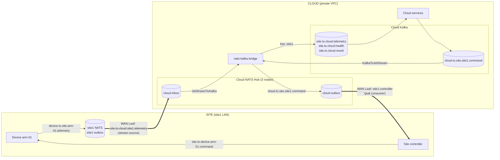
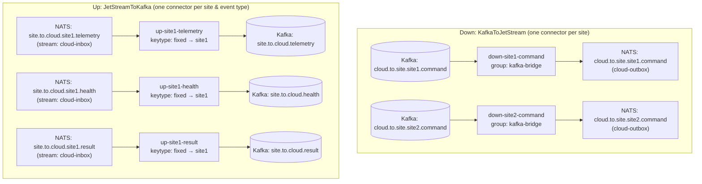
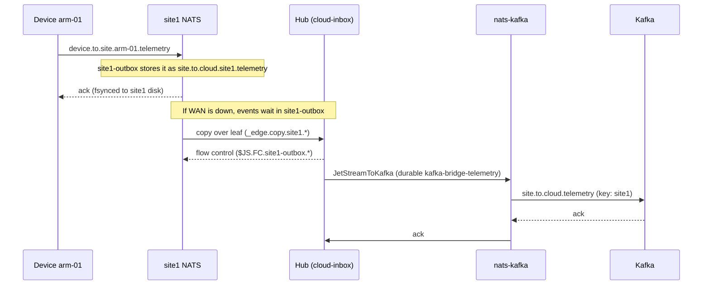
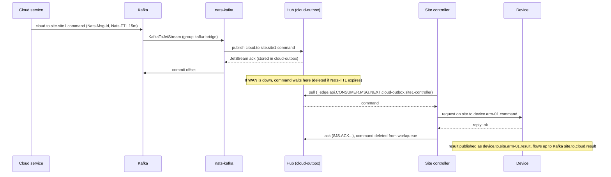

# Pattern A: Cloud NATS Hub + Leaf Nodes

Cloud services talk to **Kafka**. The official
[`nats-io/nats-kafka`](https://github.com/nats-io/nats-kafka) bridge connects
Kafka to a 3-node **Cloud NATS Hub** cluster, and each site's NATS server
connects out to that cluster as a
[leaf node](https://docs.nats.io/running-a-nats-service/configuration/leafnodes).

See [docs/comparison.md](../docs/comparison.md) and
[ADR-0003](../docs/adr/0003-direct-site-to-kafka-vs-cloud-hub.md) for how this
compares with [Pattern B (Direct Site-to-Kafka)](../pattern-b-direct-kafka/README.md).

- [Pieces](#pieces)
- [Kafka ↔ NATS bridge (nats-io/nats-kafka)](#kafka--nats-bridge-nats-ionats-kafka)
- [Up: device → Kafka](#up-device--kafka)
- [Down: Kafka → device](#down-kafka--device)
- [Ordering](#ordering)
- [Delivery speed](#delivery-speed)
- [Security](#security)
- [Failures](#failures)
- [Operating it](#operating-it)
- [Tests](#tests)

Names of subjects, streams, topics, headers and users are defined in
[docs/naming.md](../docs/naming.md). Versions: `nats-server` 2.12.5,
`natsio/nats-kafka` 1.4.2, `apache/kafka` 3.9.1 (KRaft), `nats.go` 1.46.1.
References like `server/stream.go` point to the nats-server source.

## Pieces

| Piece | Runs | Does |
|---|---|---|
| Device | site | publishes `device.to.site.<device>.<type>`, receives `site.to.device.<device>.command` |
| Site controller (your app) | site | pulls the site's commands from `cloud-outbox`, decides which device acts |
| Site server (`site1`, `site2`) | site, one per site | stores events in `<site>-outbox` until the cloud has them; dials the hub as a leaf node |
| Hub cluster (`cloud-hub-1..3`) | cloud, 3 nodes, 3× replication | `cloud-inbox` (events from all sites), `cloud-outbox` (commands for all sites) |
| `kafka-bridge` (`nats-io/nats-kafka`) | cloud | bridges Kafka `cloud.to.site.<site>.command` → `cloud-outbox`, and `cloud-inbox` → Kafka `site.to.cloud.<type>` |
| Kafka (`kafka`) | cloud | the cloud services' event bus |
| Cloud services | cloud | produce commands to Kafka; consume site events from Kafka |

Each site server connects **out** to the hub as a leaf node (TLS on 7422, or
`wss://` on 443), so sites need no inbound port. Each side runs its own
JetStream domain (`cloud`, `site1`, …), which lets the hub manage the copy of a
site's stream over that single outbound connection. Kafka is reachable only
inside the cloud; sites never talk to it.

## Kafka ↔ NATS bridge (`nats-io/nats-kafka`)

Cloud services only know Kafka. The official
[`nats-io/nats-kafka`](https://github.com/nats-io/nats-kafka) bridge
(`natsio/nats-kafka:1.4.2`) is the single component that speaks both Kafka and
NATS. Its config (`config/generated/bridge/nats-kafka.conf`) is generated by
`scripts/generate.sh` from the same `SITES` list used for NATS accounts and
streams — there is no custom bridge code to build or maintain.

### Connector rules

| Connector type | Count | Source | Destination | Ordering & key |
|---|---|---|---|---|
| `KafkaToJetStream` | 1 per site | Kafka `cloud.to.site.<site>.command` (group `kafka-bridge`) | NATS `cloud.to.site.<site>.command` (`cloud-outbox`) | 1-partition topic per site, in-order publish |
| `JetStreamToKafka` | 1 per `(site, type)` | NATS `cloud-inbox`, filter `site.to.cloud.<site>.<type>` (durable `kafka-bridge-<site>-<type>`) | Kafka `site.to.cloud.<type>` | `keytype: fixed` (`keyvalue: <site>`) sets Kafka key = `<site>`, keeping one site's events on one partition |

- **Payloads and headers** pass through unchanged. Cloud services can set
  `Nats-Msg-Id` (deduplication in `cloud-outbox`, 15 m window) and `Nats-TTL`
  (e.g. `15m`) directly on Kafka command records.
- **Unknown sites are rejected by Kafka.** `KAFKA_AUTO_CREATE_TOPICS_ENABLE`
  is `false` and `scripts/setup-kafka.sh` creates command topics only for
  configured sites, so producing to an unknown site's topic fails immediately
  at the broker.
- **Delivery guarantee:** at-least-once end to end. If the bridge crashes,
  uncommitted commands wait in Kafka and unacked events wait in `cloud-inbox`
  (7-day retention). Deduplicate commands on `Nats-Msg-Id` / `commandId` and
  events on `Nats-Msg-Id` / payload sequence.
- **Monitoring:** `nats-kafka` exposes `/healthz` and `/varz` on port `8225`
  in the demo (`http://localhost:8225/varz`).

## Up: device → Kafka

1. The device publishes with JetStream. `site1-outbox` captures
   `device.to.site.*.telemetry`, `.health` and `.result`, and its subject
   transform stores each as `site.to.cloud.site1.<type>`, dropping the device
   id. The ack comes from the site's own server, so publishing works with the
   WAN down.
2. A type not on that list (say `device.to.site.arm-01.debug`) is stored
   nowhere and never leaves the site.
3. `cloud-inbox` lists each site's outbox as a *source*. After an outage the
   copy resumes from the last event the cloud stored. Order per site is kept,
   and each event is stored once.
4. `nats-kafka` reads `cloud-inbox` through durable consumers
   (`kafka-bridge-telemetry`, `kafka-bridge-health`, `kafka-bridge-result`),
   extracts `<site>` from the subject as the Kafka record key, and produces to
   `site.to.cloud.<type>`. Cloud services consume from Kafka.

The device id travels in the payload. The cloud doesn't need it in routing,
but it's there if a service needs it.

`site1-outbox` uses `discard: new`. If the site's disk fills during a very
long outage, publishes **fail** (the device sees an error) rather than old
unsent events being dropped. Size `max_bytes` as event rate × longest outage.

## Down: Kafka → device

- The cloud addresses a **site**, never a device. Choosing the device is the
  site controller's job (scheduling, idle devices, retries).
- `cloud-outbox` is a work queue: an acked command is deleted. The controller
  acks only after the device confirms receipt, so a controller crash before
  that means redelivery, not loss.
- Commands carrying `Nats-TTL` expire in `cloud-outbox` if the site stays
  unreachable, so stale commands are never shipped.
- The controller reaches its consumer through `_edge.api.*`, not the domain
  prefix `$JS.cloud.API.*`: the hub answers `$JS.cloud.API.*` itself in every
  account, before an import could route it.

## Ordering

Kafka only guarantees order **within a single partition**, never across
partitions. This setup preserves per-site order in both directions:

| Path | How order is kept | Caveat |
|---|---|---|
| **Up:** device → `<site>-outbox` → `cloud-inbox` | JetStream sequence order per site, even across WAN outages, site crashes, and hub leader failover. | — |
| **Up:** `cloud-inbox` → `nats-kafka` → Kafka | `keytype: subjectre` sets Kafka key = `<site>`, routing all events for a site to **one partition** of `site.to.cloud.<type>`. | Ordered per `(site, type)` with **1 bridge instance per site**. Sharing one durable consumer across multiple bridge instances interleaves events. |
| **Down:** Kafka → `nats-kafka` → `cloud-outbox` | Each `cloud.to.site.<site>.command` topic has **1 partition**, so commands for a site are always read in order. | — |
| **Down:** `cloud-outbox` → site controller | Pulled in order on first delivery. | With `max_ack_pending: 100`, a failed/timed-out command redelivered after `ack_wait` (30 s) can arrive after later commands. Set `max_ack_pending: 1` if strict FIFO is required. |

Delivery is **at-least-once** end to end: consumers should deduplicate on
`Nats-Msg-Id` / `commandId` (or payload sequence).

## Delivery speed

**Up is event by event over the leaf.** The source copy is a push consumer
that sends one NATS message per stored event. `TestUplinkCopiesEventByEvent`
measures it on the site's leaf connection: 2,000 messages for 2,000 events. Up
to about 2 MB can be in flight before the site waits for a flow-control reply
(`JsFlowControlMaxPending` 32 MB ÷ 16, `server/consumer.go`).

**The up copy has no speed setting.** A stream source has no rate field
(`StreamSource`, `server/stream.go`), so the copy runs as fast as the link and
flow control allow. To limit it:
- shape traffic on the site's WAN link (router QoS or `tc`), which slows commands too;
- split the outbox into a small priority stream (health, results) and a bulk
  stream (telemetry), each copied separately, so a telemetry backlog doesn't
  delay important events;
- replace the built-in copy with a copier that reads the outbox through a
  consumer with `rate_limit_bps`.

**Down is pulled in batches, one message and one ack per command.** The site
controller sets the pace via batch size, poll interval, `max_ack_pending`
(100), and `ack_wait` (30 s). `rate_limit_bps` is not supported on pull
consumers (`server/consumer.go`).

## Security

**Identity: one certificate per site.** The hub's leaf and WebSocket listeners
use `verify_and_map`, so a site's certificate subject (`CN=site1,O=fleet`) is
its user name. There are no shared passwords, and revoking one site's
certificate touches no other site.

**Isolation: one hub account per site.** A site's leaf logs in to its own
account, which sees only what it imports. `scripts/generate.sh` generates, per
site:

| Between | What crosses | Why |
|---|---|---|
| `site1` → `cloud` | `$JS.site1.API.>`, `$JS.FC.site1-outbox.>`, `_edge.copy.site1.>` | the cloud copies `site1-outbox` |
| `cloud` → `site1` | `MSG.NEXT` / `INFO` on `site1-controller`, `$JS.ACK.cloud-outbox.site1-controller.>` | `site1` pulls and acks its own commands |

Nothing else crosses, so a site can't read another site's commands or see any
of its traffic (`TestSitesAreIsolated`).

**Roles on each hop.** Each user may use only its own hop
(`TestRolesUseOnlyTheirHop`, `TestKafkaBridgeRoleIsLimited`):
- `device`: publishes `device.to.site.>`, receives `site.to.device.>`, and may
  reply to a command it received (`allow_responses`).
- `site-controller`: publishes `site.to.device.>` and pulls its own consumer
  on `cloud-outbox`.
- `kafka-bridge`: publishes `cloud.to.site.>` and manages/acks its consumers
  on `cloud-inbox`. Cannot delete streams, read `cloud-outbox` consumers, or
  publish on `site.to.cloud.>` / `site.to.device.>`.
- `cloud-app`: publishes `cloud.to.site.>` and uses the JetStream API. Stays
  for operators and tests; cloud services use Kafka.

**Cluster routes.** Sites and hubs share one CA. Routes use
`verify_cert_and_check_known_urls`: a peer's certificate must carry a DNS name
matching a configured route, and site certificates carry none.

**Load balancer.** Any load balancer in front of the hubs must pass TLS
through (not terminate it), or the hub can't verify the site's client cert.

**Kafka.** The demo broker is plaintext on the cloud network (and
`localhost:9094`). In production enable SASL/mTLS (supported natively in
`nats-kafka` via `tls` and `sasl` blocks) and ACLs: `kafka-bridge` may read
`cloud.to.site.*.command`, write `site.to.cloud.*`, and commit group
`kafka-bridge`; cloud services may write `cloud.to.site.*.command` and read
`site.to.cloud.*`.

## Failures

| What happens | Result | Test |
|---|---|---|
| WAN link down | events acked on site disk; arrive in NATS and Kafka in order when link returns | `TestUplinkSurvivesWANOutage`, `TestKafkaUplinkSurvivesWANOutage` |
| Command `Nats-TTL` runs out during an outage | deleted in `cloud-outbox`, never delivered | `TestStaleCommandsExpireInCloud` |
| Site server killed (`kill -9`) mid-outage | nothing acked is lost | `TestSiteServerCrashDuringOutage` |
| Hub node leading `cloud-inbox` killed mid catch-up | another node takes over, no loss, queued command still delivered | `TestHubLeaderLossDuringCatchUp` |
| Site goes silent | hub emits `$SYS.ACCOUNT.<site>.DISCONNECT` | `TestSiteOfflineEvent` |
| `kafka-bridge` killed (`kill -9`) | events wait in `cloud-inbox`, commands wait in Kafka; both catch up after restart | `TestKafkaBridgeCrashLosesNothing` |
| Kafka down | events buffer in `cloud-inbox` (7-day retention); sites keep running unaffected | design ([ADR-0002](../docs/adr/0002-kafka-nats-bridge.md)) |

Timing to expect:
- **Dead link detection:** `ping_interval: 20s`, `ping_max: 2` detect a silent
  link in ~61–74 s (`TestSiteOfflineEvent`).
- **Catch-up can start late:** a failing source retries with exponential
  backoff capped at 2 minutes (`retryMaximum`, `server/stream.go`). Nothing is
  lost, and commands aren't affected.
- **Resends after a cut:** until pings notice a dead link, the site writes up
  to the 2 MB flow-control window into the dead socket, then resumes from the
  cloud's last stored sequence. `cloud-inbox` stores each event once.
- **Power loss:** `sync_interval: always` on sites flushes every write to disk
  (default is every 2 minutes).

## Operating it

**Add a site** (`site3`):
1. Add `site3` to `SITES` in the `Makefile`.
2. In `compose.yaml`, copy the `site1` service and its network, and add
   `site3` to `SITES` of `setup` and `kafka-setup`.
3. Run `make down && rm -rf certs && make up`. This regenerates certs,
   `config/generated/` (NATS accounts, site config, streams,
   `bridge/nats-kafka.conf`), and creates the `cloud.to.site.site3.command`
   Kafka topic.

**What to monitor:**
- `$SYS.ACCOUNT.<site>.DISCONNECT`: a site went offline.
- `cloud-inbox` source info, per site: *last seen* growing means that site's
  copy is stuck. Don't alert on *lag*; it reads 0 while a site is offline.
- `cloud-outbox`: pending commands and their age, per consumer.
- `<site>-outbox`: disk usage against `max_bytes`.
- `kafka-bridge` (`make kafka-status` and `http://localhost:8225/varz`):
  Kafka consumer-group lag for `kafka-bridge` on `cloud.to.site.<site>.command`,
  and pending/ack-pending on `cloud-inbox` consumers (`kafka-bridge-telemetry`,
  `kafka-bridge-health`, `kafka-bridge-result`).

**Silent failures to know about.** A request outside a site's account gets
`no responders`, and nothing is logged on the hub. A missing import or export
stops a stream source without an error. Always generate configs with
`scripts/generate.sh` and alert on source *last seen*.

## Tests

`make test` runs `e2e/` against the stack from `make up`. Tests cut WAN links
with `docker network disconnect` and kill containers, so they run sequentially.

| Test | Checks |
|---|---|
| `TestForwardUpDeviceToCloud` | each up type arrives as `site.to.cloud.<site>.<type>` without device ids; other types stay on the site |
| `TestForwardDownCloudToDevice` | command reaches the device via the controller; result comes back up; ack clears it |
| `TestRolesUseOnlyTheirHop` | device, controller and cloud app are refused the other hops |
| `TestNamingConvention` | every subject, stream and consumer name in `config/` follows [docs/naming.md](../docs/naming.md) |
| `TestUplinkSurvivesWANOutage` | publish during an outage, catch up in order |
| `TestStaleCommandsExpireInCloud` | TTL-expired command never delivered, fresh one delivered |
| `TestSiteServerCrashDuringOutage` | `kill -9` of a site server loses nothing |
| `TestHubLeaderLossDuringCatchUp` | 20,000-event catch-up survives losing the stream leader |
| `TestSitesAreIsolated` | no cross-site consumer access, no cross-site traffic |
| `TestUplinkCopiesEventByEvent` | one leaf message per event, each stored once, in order |
| `TestSiteOfflineEvent` | hub reports the site's DISCONNECT / CONNECT with its cert identity |
| `TestKafkaCommandToDeviceAndResultBack` | Kafka command reaches device; result lands in Kafka `site.to.cloud.result` keyed by site |
| `TestKafkaEventTopicsAndKeys` | each up type lands on its own topic, keyed by site, no device id in key |
| `TestKafkaUplinkSurvivesWANOutage` | events published during an outage reach Kafka in order on one partition |
| `TestKafkaBridgeCrashLosesNothing` | `kill -9` of `nats-kafka`: events wait in `cloud-inbox`, commands in Kafka, both catch up |
| `TestKafkaBridgeRoleIsLimited` | `kafka-bridge` NATS user is refused other hops, stream deletion, and `cloud-outbox` reads |
| `TestKafkaTopicNames` | every Kafka topic follows [docs/naming.md](../docs/naming.md) |
