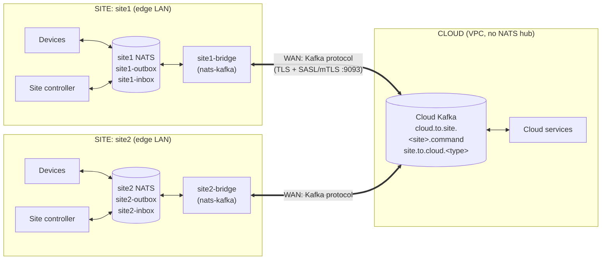
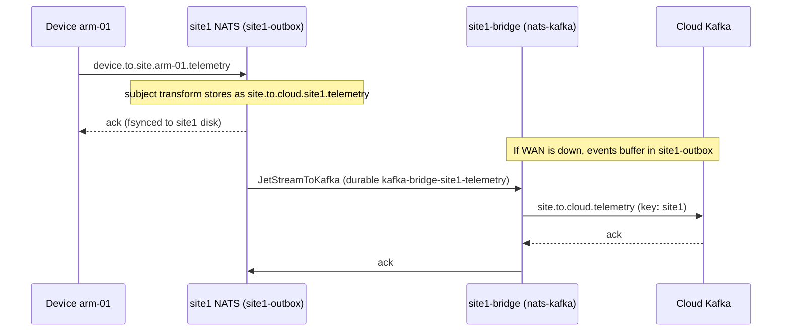
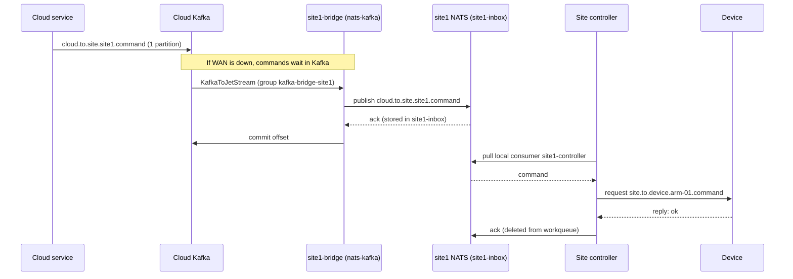

# Pattern B: Direct Site-to-Kafka (no Cloud NATS hub)

Each site runs its own local **NATS** server (`<site>-outbox`, `<site>-inbox`)
and its own local **[`nats-io/nats-kafka`](https://github.com/nats-io/nats-kafka)**
bridge that connects **directly to Cloud Kafka** over the WAN. There is no
Cloud NATS hub cluster.

- **Down (commands):** Cloud service → Cloud Kafka `cloud.to.site.<site>.command`
  → site `<site>-bridge` (`KafkaToJetStream`) → site NATS `<site>-inbox` →
  site controller → device.
- **Up (events):** Device → site NATS `<site>-outbox` → site `<site>-bridge`
  (`JetStreamToKafka`) → Cloud Kafka `site.to.cloud.<type>` (key = `<site>`) →
  cloud services.

See [docs/comparison.md](../docs/comparison.md) and
[ADR-0003](../docs/adr/0003-direct-site-to-kafka-vs-cloud-hub.md) for how this
compares with [Pattern A (Cloud NATS Hub)](../pattern-a-cloud-hub/README.md).

## Architecture



## Up: device → Cloud Kafka



## Down: Cloud Kafka → device



## Key differences from Pattern A

- **No Cloud NATS cluster to run.** Cloud infrastructure is just Kafka.
- **Bridge runs at every site.** Every site deploys and upgrades `nats-kafka`
  alongside its site NATS server.
- **Kafka is exposed to sites over WAN.** Production requires Kafka TLS +
  SASL/mTLS (and per-site Kafka ACLs restricting `site1` to
  `cloud.to.site.site1.command` and `site.to.cloud.*`). Kafka's binary protocol
  cannot traverse standard HTTPS-only corporate proxies (unlike Pattern A's
  `wss://` leaf nodes).
- **Commands live in Kafka during WAN outages.** Commands are not expired by
  `Nats-TTL` until the site reconnects and pulls them, so the site controller
  must check an `expiresAt` timestamp in the payload.

## Run it

```bash
cd pattern-b-direct-kafka
make up              # generates config, starts Kafka, site1+bridge, site2+bridge
make kafka-topics    # list Kafka topics and partitions
make status          # site1 and site2 JetStream streams
make kafka-status    # per-site Kafka consumer group lag
make down            # stop and delete all data
```

Try a WAN outage by hand:

```bash
make cut-site1       # disconnects site1-bridge from WAN; devices keep publishing to site1
make restore-site1   # site1-bridge reconnects and drains site1-outbox to Cloud Kafka
```

### Try it from Kafka

Send a command to `site1`:

```bash
echo 'site1|{"commandId":"c-42","action":"start"}' | \
  docker compose exec -T kafka /opt/kafka/bin/kafka-console-producer.sh \
  --bootstrap-server localhost:9092 \
  --topic cloud.to.site.site1.command \
  --property parse.key=true --property key.separator='|'
```

Pull it as `site1-controller` (local to `site1`):

```bash
docker compose run --rm --entrypoint sh setup -c \
  'nats --server nats://site1:4222 --user site-controller --password "$SITE_CONTROLLER_PASS" consumer next site1-inbox site1-controller --count 1 --ack'
```

Read telemetry in Cloud Kafka:

```bash
docker compose exec kafka /opt/kafka/bin/kafka-console-consumer.sh \
  --bootstrap-server localhost:9092 \
  --topic site.to.cloud.telemetry \
  --from-beginning --property print.key=true
```

## Endpoints

| Service | Address | Notes |
|---|---|---|
| Cloud Kafka | `localhost:9094` | plaintext (dev only) |
| `site1` NATS | `nats://localhost:4223` (monitor `:8223`) | users: `device`, `site-controller`, `site-ops` |
| `site2` NATS | `nats://localhost:4224` (monitor `:8224`) | users: `device`, `site-controller`, `site-ops` |
| `site1-bridge` monitor | `http://localhost:8225/varz` | `/healthz`, `/varz` |
| `site2-bridge` monitor | `http://localhost:8226/varz` | `/healthz`, `/varz` |
