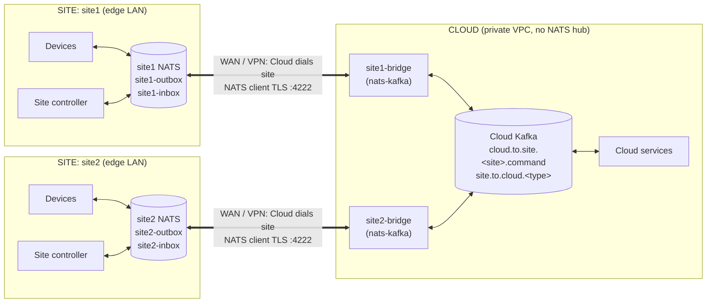
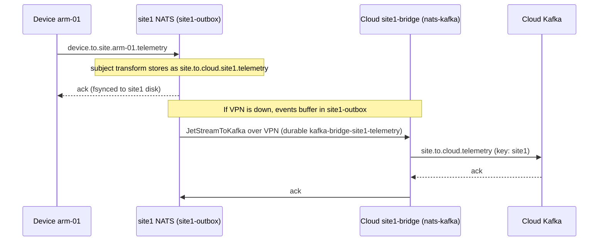
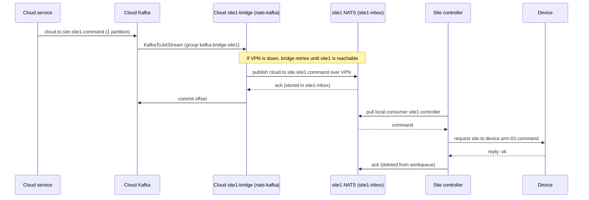

# Pattern C: Cloud Bridge → Site NATS (no Cloud NATS hub)

Each site runs **only** its local **NATS** server (`<site>-outbox`,
`<site>-inbox`). There is **no Cloud NATS Hub**. Instead, per-site
[`nats-io/nats-kafka`](https://github.com/nats-io/nats-kafka) bridge containers
run **in the Cloud VPC** next to Cloud Kafka and connect over a private
VPN / WAN tunnel directly into each site's NATS server (`:4222`, TLS in
production).

- **Down (commands):** Cloud service → Cloud Kafka `cloud.to.site.<site>.command`
  → Cloud `<site>-bridge` (`KafkaToJetStream`) → *(VPN)* → site NATS
  `<site>-inbox` → site controller → device.
- **Up (events):** Device → site NATS `<site>-outbox` → *(VPN)* → Cloud
  `<site>-bridge` (`JetStreamToKafka`) → Cloud Kafka `site.to.cloud.<type>`
  (key = `<site>`) → cloud services.

See [docs/comparison.md](../docs/comparison.md) and
[ADR-0003](../docs/adr/0003-direct-site-to-kafka-vs-cloud-hub.md) for how this
compares with [Pattern A (Cloud NATS Hub)](../pattern-a-cloud-hub/README.md)
and [Pattern B (Site Bridge → Cloud Kafka)](../pattern-b-direct-kafka/README.md).

## Architecture (Site vs Cloud boundary)



## Up: device → Cloud Kafka



## Down: Cloud Kafka → device



## Key differences from Pattern A and Pattern B

- **Minimal site footprint (like Pattern A):** sites only run `nats-server`.
  Bridges are deployed, upgraded, and monitored centrally in the cloud.
- **Cloud Kafka stays strictly private (like Pattern A):** Kafka is only on
  the private `cloud` network; sites never talk to Kafka.
- **No Cloud NATS Hub (like Pattern B):** no 3-node Cloud NATS cluster to run.
- **Requires Cloud → Site VPN reachability:** the cloud bridges must be able
  to dial inbound into `<site>:4222` over a private VPN / tunnel (WireGuard,
  Tailscale, IPsec, Direct Connect). Does not work for outbound-only NAT sites.
- **One bridge container per site in the cloud:** each `nats-kafka` process
  connects to one NATS server, so 50 sites = 50 lightweight `nats-kafka`
  containers in the cloud.

## Run it

```bash
cd pattern-c-cloud-bridge-direct
make up              # generates config, starts Cloud Kafka, cloud bridges, site1 & site2 NATS
make kafka-topics    # list Kafka topics and partitions
make status          # site1 and site2 JetStream streams
make kafka-status    # per-site Kafka consumer group lag
make down            # stop and delete all data
```

Try a VPN outage by hand:

```bash
make cut-site1       # disconnects site1 from WAN/VPN; devices keep publishing locally
make restore-site1   # cloud site1-bridge reconnects and drains site1-outbox to Cloud Kafka
```

## Endpoints

| Service | Runs in | Address |
|---|---|---|
| Cloud Kafka | Cloud | `localhost:9094` (plaintext in dev) |
| `site1-bridge` monitor | Cloud | `http://localhost:8225/varz` |
| `site2-bridge` monitor | Cloud | `http://localhost:8226/varz` |
| `site1` NATS | Site 1 | `nats://localhost:4223` (monitor `:8223`) |
| `site2` NATS | Site 2 | `nats://localhost:4224` (monitor `:8224`) |
